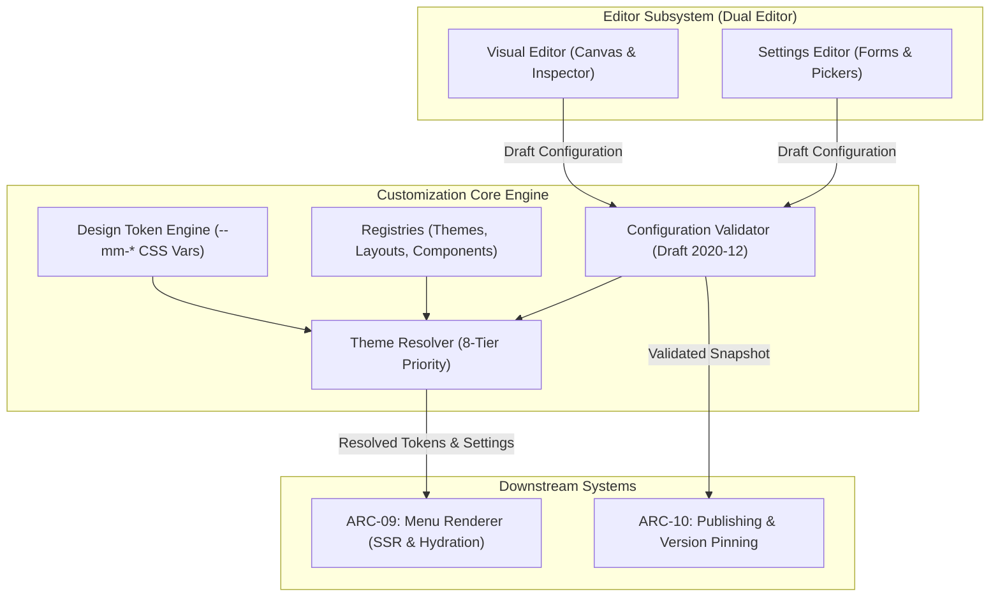

# ARC-08: 01 — Architecture Overview

## 1. System Context & Boundaries
The theme and customization system operates as a core domain module within ModularMenu's modular monolith.

## 2. Logical Subsystems
1. **Design Token Engine**: Semantic visual tokens with allowlist validation and deterministic CSS variable generation.
2. **Theme Preset Catalogue**: Platform-owned immutable visual presets (Minimal, Luxury, Rustic, Contemporary, Vibrant, Editorial).
3. **Layout Engine**: Structural arrangement presets (List, Grid, Image Cards, Editorial Sections) with 5 responsive breakpoints.
4. **Component Registry**: Platform-controlled catalogue of 13 approved UI components with slot constraints.
5. **Customization Validation Engine**: Multi-stage validation enforcing schemas, semantic policies, and size limits.
6. **Theme Resolution Engine**: Pure, deterministic function combining 8 layers into normalized renderable configuration.
7. **Draft & Persistence Subsystem**: Optimistic concurrency control via revision numbers and tenant-isolated PostgreSQL JSONB.
