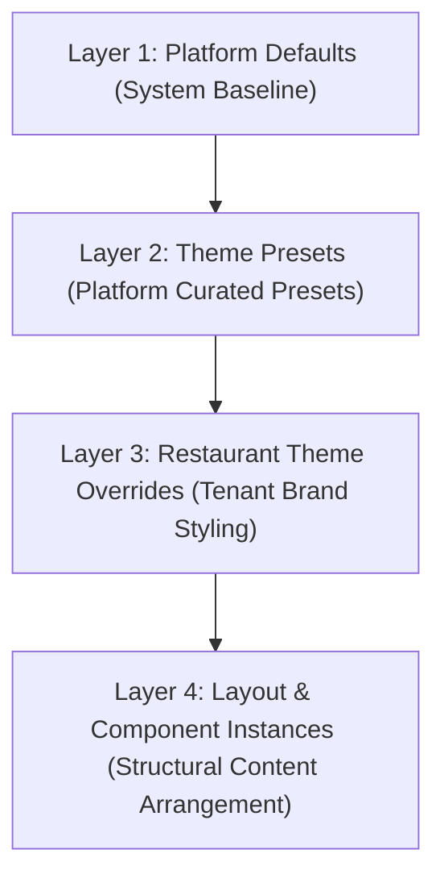

# ARC-08: 03 — Customization Hierarchy

## 1. The Four Configuration Layers
Customization is structured into four distinct layers:

## 2. Priority Hierarchy (8 Tiers)
When resolving visual styles and layout properties, the resolver traverses exactly 8 tiers:
1. **Platform Defaults**: Default design tokens (`DEFAULT_DESIGN_TOKENS`).
2. **Theme Preset**: Base tokens defined by `theme.id` and `theme.version`.
3. **Restaurant Theme Overrides**: Tenant-specific token overrides (`theme.overrides`).
4. **Layout Defaults**: Default settings of selected layout (`layout.id`).
5. **Layout Settings**: Tenant overrides for columns, density, and category styles.
6. **Component Registry Defaults**: Platform defaults for instantiated components.
7. **Component Instance Props**: Tenant-configured properties on specific component instances.
8. **Responsive Overrides**: Viewport-specific overrides (`layout.responsive[breakpoint]`).
