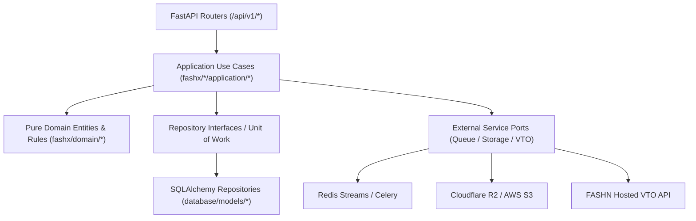

# FashXStudio — Repository Structure & Application Architecture Audit

**Document ID:** `FASHX-AUD-001`  
**Phase:** `Phase 02 — Repository Audit and Engineering Consolidation`  
**Section:** `2.2 — Repository Structure & Subsystem Architecture`  
**Date:** `11 November 2026`  
**Status:** `AUDIT COMPLETE — VERIFIED BASELINE`  

---

## 1. Physical Directory Tree & Subsystem Mapping

The FashXStudio repository is organized as a unified full-stack monorepo encompassing backend REST services, asynchronous workers, a cross-platform mobile application, database migrations, and CI/CD quality pipelines:

```text
FashXStudio/
├── backend/fashx/               # Core Python application (FastAPI, Clean Architecture)
│   ├── api/v1/                  # REST endpoints (me, onboarding, analytics, system)
│   ├── catalog/                 # Ingestion adapters, normalization, enrichment, deduplication
│   ├── commerce_wardrobe/       # Digital wardrobe, buy-click referrals, fit feedback
│   ├── core/                    # Settings, logging, runtime, error types, idempotency
│   ├── domain/                  # Pure domain entities, business rules, lifecycle logic
│   ├── infrastructure/          # Database sessions, storage adapters (S3/R2/local), Redis queues
│   ├── profile/                 # Body preferences, privacy consent, photo upload/validation
│   ├── recommendation/          # Candidate retrieval, MMR ranker, scoring algorithms
│   ├── security/                # JWT auth, tenant isolation, rate limiting, SSRF protection
│   ├── tryon/                   # VTO job orchestration, FASHN API adapter, quality checks
│   ├── visual/                  # Design token API, screen metadata, responsive layouts
│   └── main.py                  # ASGI entry point and FastAPI application factory
├── mobile/                      # Cross-platform mobile app (React Native / Expo SDK 58)
│   ├── app/                     # File-based routing (Expo Router): (auth), (tabs), (gates), onboarding
│   ├── features/                # Visual design system components, templates, styling matrix
│   ├── src/                     # Core API client, query hooks, state stores (Zustand), i18n
│   ├── __tests__/               # 21 Jest test suites covering offline auth, VTO polling, redirects
│   └── package.json             # Mobile manifest and dependencies
├── database/                    # Persistence layer
│   ├── models/                  # SQLAlchemy 2.0 ORM models (Base, catalog, profile, tryon, tenant)
│   └── migrations/              # Alembic migration revisions (0001_foundation to 0032_head)
├── workers/                     # Dedicated asynchronous processing workers
│   ├── profile_photo/           # MediaPipe pose extraction and photo quality gate worker
│   ├── skin_tone/               # ITA (Individual Typology Angle) skin tone calibrator
│   └── tryon_gpu/               # GPU try-on worker runner and API client dispatch
├── tests/                       # Automated backend and integration test suites (360 files)
│   ├── unit/                    # Unit tests for domain logic, normalizers, VTO validators
│   ├── integration/             # Component and API router integration tests
│   ├── security/                # Auth, token expiration, rate limiting, and tenant boundary tests
│   ├── contracts/               # Pydantic schema and API wire contract verification
│   └── release/                 # Contractual release gate evaluators (G1–G6)
├── docs/                        # Project governance, architecture, and product baseline
│   ├── adr/                     # Architectural Decision Records (ADR-0001 to ADR-0009)
│   ├── product/                 # Phase 01 baseline (PRD, Strategy, Scope, Journeys, Decisions)
│   ├── audit/                   # Phase 02 repository audit artifacts and subsystem registers
│   ├── logs/                    # Historical task logs and developmental logs
│   ├── vto/                     # VTO metrics, quality rubrics, and evaluation protocols
│   ├── analytics/               # Universal Event Envelope and rollup pipeline contracts
│   └── release/                 # Formal release gates (gates.md — human founder owned)
├── scripts/                     # Operational, evaluation, and CI automation scripts
├── .github/workflows/           # GitHub Actions workflows (ci.yml, deploy.yml, rc08-staging.yml)
├── alembic.ini                  # Alembic CLI configuration
├── docker-compose.yml           # Local multi-service infrastructure (Postgres 16 pgvector, Redis 7)
├── Dockerfile                   # Multi-stage production container build specification
├── pyproject.toml               # Python package manifest, dependencies, and tooling configuration
└── pytest.ini                   # Pytest test discovery and execution configuration
```

---

## 2. Backend Application Entry Points & Lifecycle (2.2.1)

### A. Factory and ASGI Initialization
- **Primary Source File:** [`backend/fashx/main.py`](file:///c:/Users/ASUS/Documents/FashXStudio/backend/fashx/main.py#L24-L190)
- **Application Factory:** `create_app(settings: Any | None = None) -> FastAPI` (line 24)
- **ASGI Instance:** `app = create_app()` (line 190)
- **Production ASGI Command:**
  ```bash
  gunicorn -k uvicorn.workers.UvicornWorker -w 2 -b 0.0.0.0:8000 --timeout 90 fashx.main:app
  ```
- **Local Dev Command:**
  ```bash
  uvicorn fashx.main:app --host 0.0.0.0 --port 8000 --reload
  ```

### B. Middleware Pipeline
The application registers three global middleware layers executed in order:
1. `SecurityHeadersMiddleware`: Injects standard defensive headers (`X-Content-Type-Options: nosniff`, `X-Frame-Options: DENY`, `Referrer-Policy: strict-origin-when-cross-origin`).
2. `RequestContextMiddleware`: Extracts or generates `X-Request-ID` and `X-Trace-ID` and binds request context to the logging context filter.
3. `CORSMiddleware`: Governs cross-origin requests using configurable origins from settings (`CORS_ORIGINS`).

### C. Exception Handlers
- `install_exception_handlers(app)`: Intercepts `RequestValidationError` and unhandled exceptions to prevent stack trace leakage.
- `app.add_exception_handler(ApiError, api_error_handler)`: Standardizes security and authorization error envelopes (`fashx.security.errors.ApiError`).
- `app.add_exception_handler(CoreError, core_error_handler)`: Catches domain-level constraint and conflict violations (`fashx.core.errors.CoreError`).

---

## 3. API Routing & Domain Breakdown (2.2.2)

The backend exposes **222 OpenAPI endpoints** grouped into standard architectural domains:

| Domain | Route Prefix | Primary Router File | Access Dependency | Description |
| :--- | :--- | :--- | :--- | :--- |
| **System & Health** | `/`, `/healthz` | `fashx.health.router` | Public | Kubernetes liveness (`/healthz/live`), readiness (`/healthz/ready`), service ping. |
| **Identity & Me** | `/api/v1/me` | `fashx.api.v1.me` | `get_principal` | Current user profile, DPDP consent management, account self-erasure (`DELETE /me`). |
| **Onboarding** | `/api/v1/onboarding` | `fashx.api.v1.onboarding` | `get_principal` | Style quiz question retrieval, visual archetype selection, preference seeding. |
| **Profile & Photos** | `/api/v1/profile` | `fashx.profile.router` | `get_principal` | User body silhouette profiling, photo upload URL generation, photo deletion. |
| **Catalog (Public)** | `/api/v1/garments` | `fashx.catalog.customer_router` | `get_principal` | Shopper product browsing, garment detail view, size availability. |
| **Catalog (Admin)** | `/api/v1/catalog` | `fashx.catalog.router` | `require_role("admin")` | Admin catalog ingestion, garment enrichment trigger, quality audit inspection. |
| **Recommendations** | `/api/v1/feed` | `fashx.recommendation.feed_router` | `get_principal` | Personalized infinite fashion feed, implicit/explicit preference signals. |
| **Virtual Try-On** | `/api/v1/tryon` | `fashx.tryon.router` | `get_principal` | Asynchronous try-on job dispatch, job status polling, signed result retrieval. |
| **Wardrobe & Commerce** | `/api/v1/wardrobe`, `/commerce` | `fashx.commerce_wardrobe.router` | `get_principal` | Saved looks, closet management, outbound buy-click tracking, fit feedback. |
| **Analytics** | `/api/v1/analytics` | `fashx.api.v1.analytics` | `get_principal` | Client telemetry ingestion, session event recording, aggregate metrics. |
| **B2B Merchant Portal** | `/merchant` | `fashx.b2b.dashboard` | `X-FashX-Key` | Merchant operational dashboard, return-rate ROI tracking (flagged via `enable_b2b`). |
| **B2B Storefront Widget**| `/widget/v1` | `fashx.b2b.widget` | Origin / API Key | Storefront embedded try-on widget session initialization and photo dispatch. |
| **Visual Design System** | `/api/v1/visual` | `fashx.visual.router` | `get_principal` | Design tokens, skin tone palettes, responsive layout calculators, screen metadata. |
| **Frozen Commerce** | `/api/v1/cart`, `/checkout` | `fashx.api.v1.cart`, etc. | Unmounted | Post-MVP cart, checkout, payments, orders (gated by `FASHX_ENABLE_FROZEN`). |

---

## 4. Domain & Service Layers (2.2.3)

FashXStudio enforces Clean Architecture separation between HTTP delivery, business use cases, and persistence adapters:



### End-to-End Try-On Execution Trace:
1. **HTTP Submission:** Shopper submits photo and garment ID to `POST /api/v1/tryon/jobs`.
2. **Authentication & Consent:** `get_principal` validates JWT; `profile_repository` confirms active DPDP consent and photo validity.
3. **Job Creation:** `create_job.py` generates deterministic `cache_key` based on `(user_id, garment_id, photo_hash)`.
4. **Outbox / Queue Dispatch:** Try-on job record persisted to PostgreSQL in `QUEUED` state; job ID pushed to Redis queue.
5. **Worker Execution:** Background worker (`fashx/tryon/application/worker.py`) claims job, transitioning status to `PROCESSING`.
6. **Inference Call:** `fashn_api.py` dispatches validated image URLs to FASHN API (`tryon-v1.6 / Try-On Max`).
7. **Quality Validation:** Output image inspected against defect detector and watermarked with C2PA metadata.
8. **Result Persistence:** Result stored in object storage; PostgreSQL record updated to `COMPLETED` with latency and cost telemetry.

---

## 5. Database Schema & Migrations (2.2.4–2.2.5)

- **Database Engine:** PostgreSQL 16 with `pgvector` extension.
- **ORM Framework:** SQLAlchemy 2.0 with asynchronous `asyncpg` driver in production and `psycopg` in test pipelines.
- **Migration Engine:** Alembic (`alembic.ini` pointing to `database/migrations/`).
- **Revision Chain:** Linear migration history comprising 32 revisions (`0001_foundation` through `0032_tryon_feedback_issue_tags`).
- **Head Status:** Single unified head (`0032_tryon_feedback_issue_tags`).

### Core Tables & Ownership:
- `users`, `auth_identities`: Authentication and account state.
- `user_profiles`, `profile_preferences`, `profile_measurements`: Self-declared shopper sizing and silhouette preferences.
- `user_consents`, `consent_events`: DPDP 2023 compliance audit trail with purpose-specific consent timestamps and revocation records.
- `garments`, `garment_variants`, `garment_enrichments`: Canonical fashion catalog, normalized attributes, and 512-d CLIP vector embeddings.
- `catalog_sources`, `catalog_source_clearances`: Merchant feed provenance, licensing clearance, and takedown tracking.
- `tryon_jobs`, `tryon_artifacts`, `tryon_feedback`: Asynchronous VTO job state machine, signed image pointers, and user quality feedback.
- `wardrobe_items`, `buy_clicks`: Shopper saved looks and outbound merchant storefront referral analytics.
- `tenants`, `tenant_api_keys`: Multi-tenant merchant isolation.

---

## 6. Mobile Application Architecture (2.2.14–2.2.15)

- **Framework:** React Native 0.76+ powered by Expo SDK 58.
- **Routing:** File-based navigation via Expo Router (`mobile/app/`):
  - `(auth)`: Phone verification, JWT exchange, dev-token bypass for staging.
  - `(gates)`: App maintenance and forced update blocking screens.
  - `onboarding`: Style quiz, body silhouette profiling, photo capture, camera consent.
  - `(tabs)`: 4-tab shell:
    - `feed.tsx`: Infinite personalized product discovery feed.
    - `explore.tsx`: Category and brand browsing.
    - `looks.tsx`: Saved VTO lookbook and outfit combinations.
    - `closet.tsx`: Digital wardrobe and purchase intent handoff.
  - `tryon/[jobId].tsx`: Real-time VTO polling screen with retry and cancel handlers.
  - `garment/[id].tsx`: Product detail page with outbound merchant redirect.
- **State Management & Network:**
  - `TanStack Query (React Query)`: Server state caching, stale-while-revalidate feed management, and exponential backoff polling.
  - `Zustand`: Client stores (`authStore.ts`, design token preferences).
  - `mobile/src/api/client.ts`: Central Axios client injecting Bearer tokens, correlation IDs (`X-Request-ID`), and standardizing network error codes.
