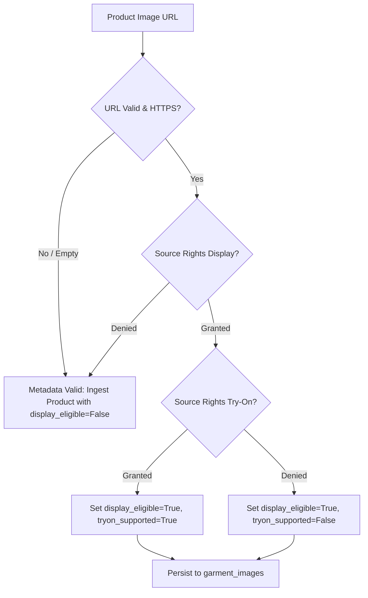

# Image Ingestion Policy

## 1. Scope & Isolation Principle

Product images are treated with strict copyright and pipeline isolation. Missing, invalid, or unpermitted images must **never** prevent valid apparel metadata from being ingested into the catalog.

---

## 2. Granular Permissions Enforcement

1. **`IMAGE_FETCH` & `IMAGE_STORE`**: Evaluated during image acquisition. If storage permission is denied, raw image URLs are not archived to S3.
2. **`IMAGE_DISPLAY`**: If display rights are withheld by contract, the product is persisted without public imagery (`display_eligible = False`).
3. **`VTO_PROCESS` / `IMAGE_AI_PROCESS`**: Explicit permission is mandatory for virtual try-on pipelines. Lack of try-on consent sets `tryon_supported = False` while allowing consumer browsing.
