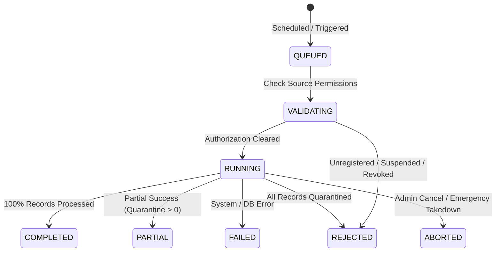

# Ingestion Job Lifecycle

## 1. Lifecycle States

Every catalog ingestion execution is tracked in PostgreSQL via `IngestRun` with the following lifecycle states:

---

## 2. IngestRun Schema Extensions

In Alembic migration `0040_add_catalog_ingestion_quarantine.py`, `IngestRun` was enhanced with:
- `merchant_id`: Direct relational link to the owning merchant.
- `sync_mode`: `'full'`, `'incremental'`, or `'batch'`.
- `correlation_id`: Distributed tracing UUID matching upstream caller context.
- `counts`: Structured JSON metrics dictionary (`total`, `validated`, `inserted`, `updated`, `unchanged`, `rejected`, `quarantined`).
