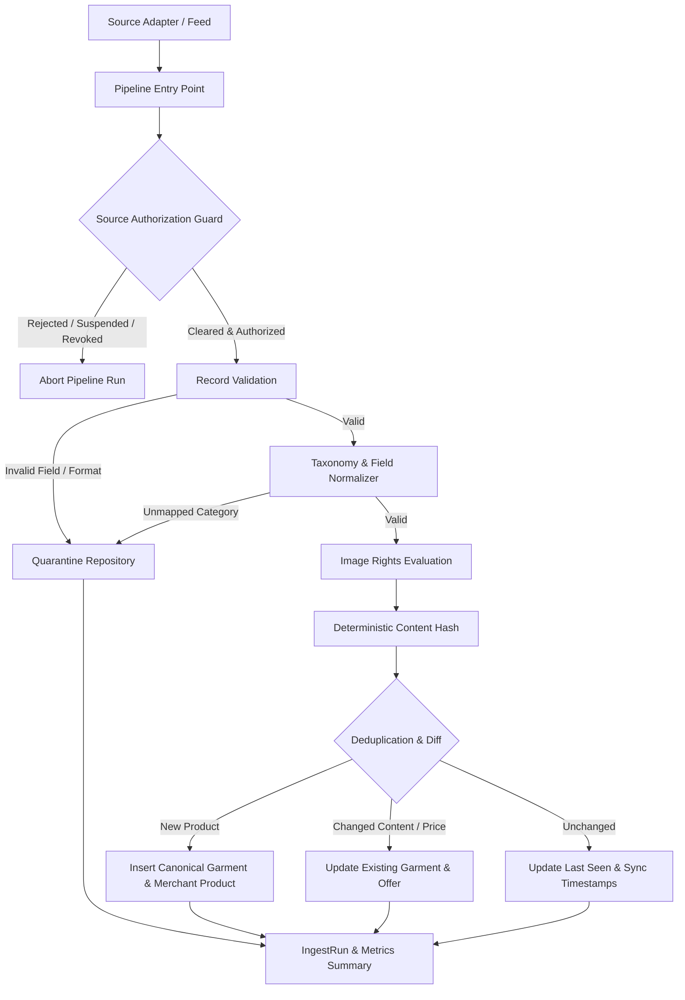

# Ingestion Pipeline Architecture

## 1. Overview and Core Principle

The FashXStudio catalog ingestion pipeline provides a resilient, permission-aware, idempotent transformation engine that maps external merchant products into the canonical catalog model.

The non-negotiable core invariant governing catalog ingestion is:

> **A product record is not eligible for the FashXStudio catalog simply because a source adapter returned it. It must pass source authorization, field validation, normalization, deduplication, and persistence checks before it can be published.**

---

## 2. Structural Components

| Component | Module | Responsibility |
| :--- | :--- | :--- |
| **Ingestion Pipeline** | `backend/fashx/catalog/acquisition/pipeline.py` | Orchestrates batch processing, handles transactions, collects run metrics, and updates `IngestRun`. |
| **Authorization Guard** | `backend/fashx/catalog/authorization/guard.py` | Verifies source status, merchant verification status, and granular rights (`PRODUCT_DATA_READ`, `PRODUCT_DATA_STORE`). |
| **Record Validator** | `backend/fashx/catalog/acquisition/record_validation.py` | Enforces mandatory field existence, types, allowed domains, HTTPS protocols, and formats. |
| **Canonical Normalizer** | `backend/fashx/catalog/acquisition/normalizer.py` | Maps taxonomy strictly (rejecting unmapped categories), normalizes brand names conservatively, parses minor currency units, and normalizes colors and sizes. |
| **Image Validator & Policy** | `backend/fashx/catalog/acquisition/images.py` | Evaluates granular image rights; isolates image failures so valid metadata is never rejected. |
| **Quarantine Service** | `backend/fashx/catalog/acquisition/quarantine.py` | Idempotently persists non-compliant payloads with reason codes for administrative review and reprocessing. |
| **Unit of Work** | `backend/fashx/catalog/uow.py` | Manages relational persistence across `CanonicalGarment`, `MerchantProduct`, `MerchantOffer`, `GarmentImage`, and `IngestRun`. |

---

## 3. Transactional Boundaries & Failure Handling

1. **Source Authorization Failure**: If a source is unregistered, suspended, expired, or lacks `PRODUCT_DATA_READ`/`PRODUCT_DATA_STORE` permissions, the run is terminated immediately with status `REJECTED`. No records are parsed or persisted.
2. **Item-Level Failures**: If an individual record fails field validation or category mapping, it is captured in `catalog_ingestion_quarantine`. Remaining records in the batch continue processing.
3. **Database Isolation**: Product creation, offer insertion, and image metadata updates occur within atomic Unit of Work sessions, ensuring database consistency.
