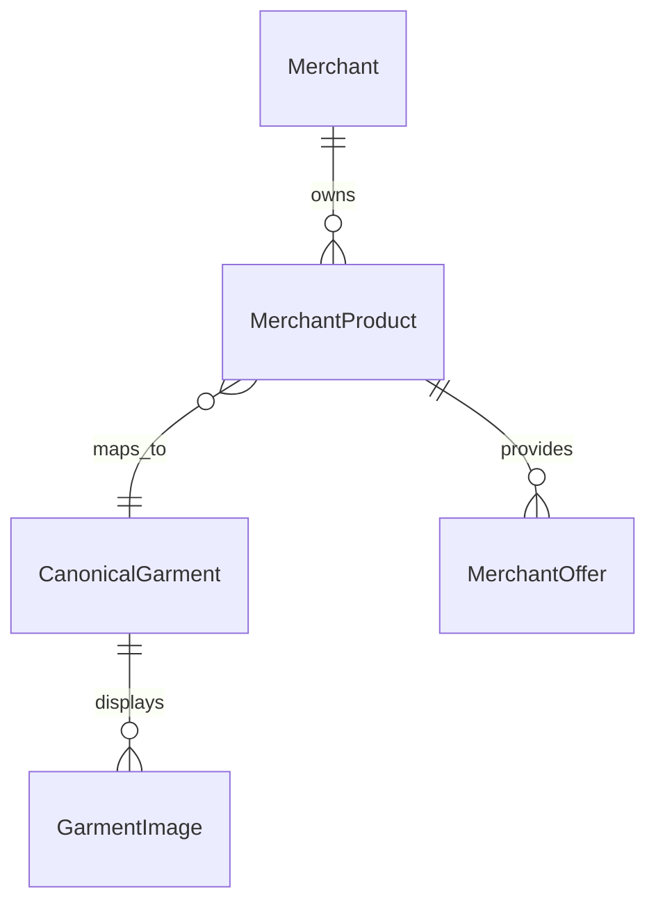

# Product Identity and Deduplication

## 1. Identity Hierarchy

FashXStudio separates product representation into two layers:
1. **Merchant Product (`MerchantProduct`)**: Bound to the specific retailer/merchant via `(merchant_id, source_product_id)`.
2. **Canonical Garment (`CanonicalGarment`)**: Represents the garment entity shown in consumer search, recommendations, and virtual try-on.



---

## 2. Invariant: Merchant Isolation

- Two merchants providing a product with the same title or identifier (`source_product_id="SKU-100"`) do **not** overwrite each other. They create independent `MerchantProduct` and `MerchantOffer` records.
- Cross-merchant deduplication is never performed solely on product titles to prevent incorrect garment merging.

---

## 3. Deterministic Content Hashing

Each incoming record's canonical fields are digested using SHA-256:
```python
content_hash = hashlib.sha256(
    f"{source_product_id}|{title}|{brand_name or ''}|{category}|{subcategory or ''}|"
    f"{price_minor}|{currency}|{product_url}|{in_stock}|{','.join(sizes)}".encode("utf-8")
).hexdigest()
```

### Ingestion Diffing Logic
- **Unchanged Record**: If `existing_prod.content_hash == content_hash` and offer price/stock are unchanged, the database record is untouched except for updating `last_seen_at` and `last_synced_at`. Counted as `unchanged`.
- **Updated Record**: If `content_hash` differs, or price/stock changed, `MerchantProduct`, `CanonicalGarment`, and `MerchantOffer` are updated with the latest details and timestamp. Counted as `updated`.
- **New Record**: If `(merchant_id, source_product_id)` does not exist, new entities are persisted. Counted as `inserted`.
