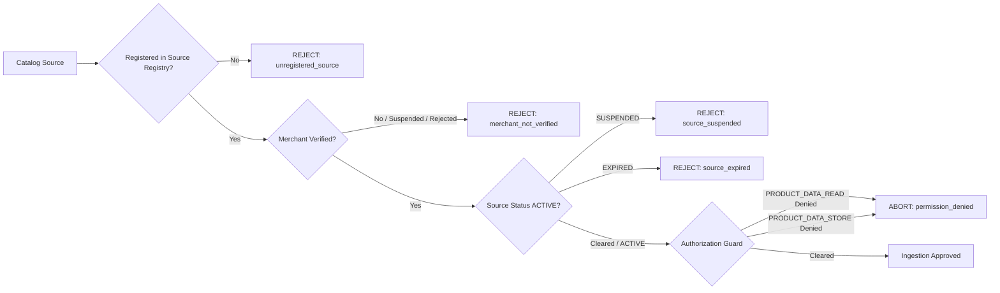

# Source Validation Policy

## 1. Source Lifecycle and Verification Gates

Catalog ingestion executes only against sources that satisfy all verification gates defined in Phase 05.1:

---

## 2. Granular Permission Evaluation

Every ingestion job checks the dynamic `CatalogAuthorizationGuard`:
- **`PRODUCT_DATA_READ`**: Required to fetch and read raw catalog feeds.
- **`PRODUCT_DATA_STORE`**: Required to write product records into `CanonicalGarment` and `MerchantProduct`.
- **`IMAGE_FETCH` & `IMAGE_STORE`**: Evaluated per item to determine if primary image assets can be retrieved and stored.
- **`IMAGE_DISPLAY`**: Controls whether product images may be rendered in customer-facing UI.
- **`VTO_PROCESS` / `IMAGE_AI_PROCESS`**: Evaluated for virtual try-on and AI pipelines; never automatically implied by image display permissions.

---

## 3. Takedown & Mid-Run Suspension Rules

1. If an active takedown exists for a source or merchant, ingestion jobs terminate immediately.
2. If authorization or source status is suspended mid-run, ongoing record writes abort safely, avoiding partial uncommitted corruptions.
