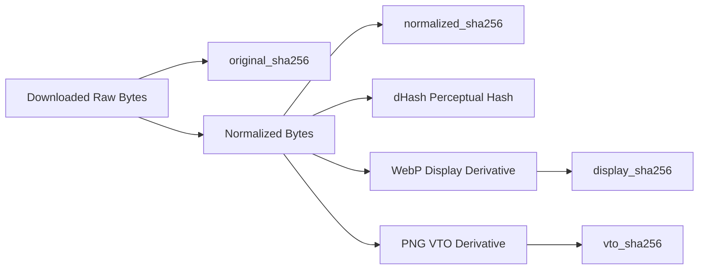

# Image Hashing and Deduplication

## 1. Multi-Stage Hashing Pipeline

FashXStudio computes cryptographic and perceptual hashes across multiple lifecycle stages:

---

## 2. Hash Specifications

1. **`original_sha256`**: Exact SHA-256 hex digest of the raw byte stream as returned by the merchant source.
2. **`normalized_sha256`**: SHA-256 hex digest of bytes after orientation transpose and clean normalization.
3. **`perceptual_hash`**: 64-bit difference hash (dHash) computed by resizing to 9×8 grayscale and evaluating horizontal gradient differences.
4. **`output_sha256`**: SHA-256 hex digest of each generated derivative.

---

## 3. Deduplication Isolation Policy (IMG-025 & IMG-026)

- **Same Product Ingestion**: When the exact same image bytes are re-ingested for the same `(source_id, source_product_id)`, the existing asset is reused idempotently without redundant storage writes.
- **Stock Photography & Shared Assets**: When two distinct products (`PRODUCT-A` and `PRODUCT-B`) or variants share the same stock image, the system preserves independent `CatalogImageAsset` records bound to each product's specific permissions. Shared visual appearance **never** automatically merges distinct product records.
