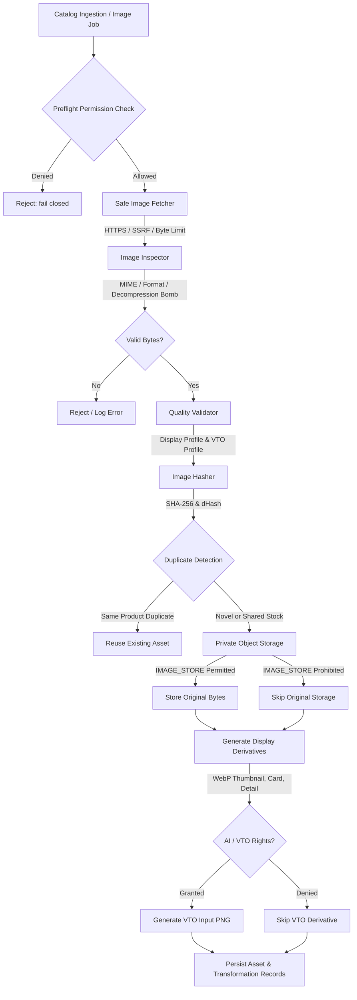

# Image Pipeline Architecture

## 1. Overview and Core Principle

The FashXStudio Product Image Pipeline provides a secure, permission-aware, and reproducible image ingestion, transformation, and takedown subsystem.

The non-negotiable core architectural invariant governing this phase is:

> **An image URL is not permission to download; permission to download is not permission to store; permission to display is not permission to process with AI; and permission to process is not automatically permission to create or retain a VTO derivative.**

---

## 2. Component Structure

| Component | Module | Responsibility |
| :--- | :--- | :--- |
| **`ProductImagePipeline`** | `backend/fashx/catalog/images/pipeline.py` | Orchestrates end-to-end flow, fail-closed rights checks, deduplication, and compensation cleanup. |
| **`ImagePermissionService`** | `backend/fashx/catalog/images/permissions.py` | Granular permission evaluation via `CatalogAuthorizationGuard`. |
| **`SafeImageFetcher`** | `backend/fashx/catalog/images/fetcher.py` | Enforces HTTPS, host allowlists, SSRF IP defense, DNS rebinding guards, streaming byte limits, and safe failure codes. |
| **`ImageInspector`** | `backend/fashx/catalog/images/inspector.py` | Validates magic bytes, decodes formats (JPEG, PNG, WebP), catches decompression bombs, checks dimensions (400–4096px), transposes EXIF orientation, strips metadata. |
| **`ImageQualityValidator`** | `backend/fashx/catalog/images/quality.py` | Evaluates display and VTO profiles (`PASS`, `REVIEW`, `REJECT`, `NOT_APPLICABLE`). |
| **`ImageHasher`** | `backend/fashx/catalog/images/hasher.py` | Computes SHA-256 for original, normalized, and derivative bytes, and perceptual difference hash (dHash). |
| **`ImageStorageService`** | `backend/fashx/catalog/images/storage_service.py` | Manages private object storage paths, signed URLs, and rollback cleanup. |
| **`ImageTransformationService`** | `backend/fashx/catalog/images/transformations.py` | Creates versioned WebP display derivatives and garment-preserving PNG VTO inputs. |
| **`ImageLifecycleService`** | `backend/fashx/catalog/images/lifecycle.py` | Orchestrates takedowns, immediate asset suspension, cascade object deletion, and retry tracking. |

---

## 3. Transactional Compensation & Failure Handling

If a database write fails after storage uploads have commenced, the pipeline catches the error, calls `storage.delete()` on all newly created keys, and reports `db_commit_failed`, preventing orphaned object accumulation in S3.
