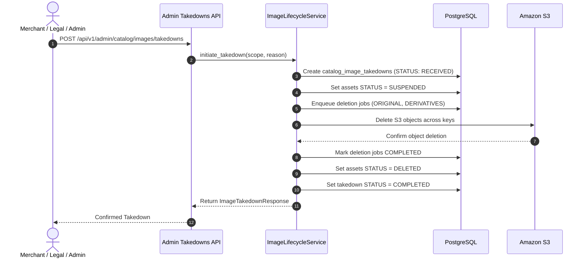

# Image Takedown and Deletion Runbook

## 1. Takedown Workflow Sequence

Image takedown is an integrated legal, security, and object lifecycle workflow:

---

## 2. Durability & Retry Invariants

1. **Immediate Suspension**: Upon receipt of a takedown, assets are set to `SUSPENDED` immediately, blocking subsequent pre-signed URL generation and AI processing before deletions finish.
2. **Per-Object Audit**: Deletions are tracked per target key in `catalog_image_deletion_jobs`.
3. **Partial Failure Resilience**: If an S3 delete call fails, the job remains `FAILED` with incremented retry count, and takedown status remains `PROCESSING` until confirmed.
