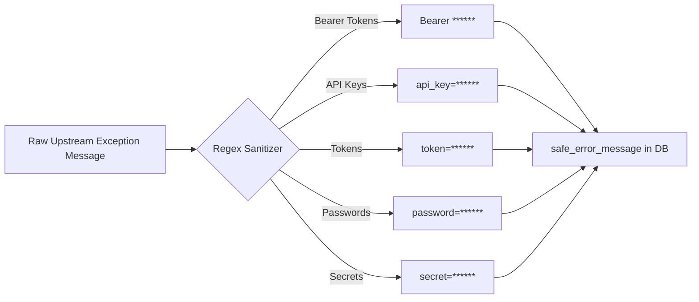

# Ingestion Failure Reporting

## 1. Overview
The ingestion failure reporting subsystem provides structured, granular error logs for failed synchronizations while guaranteeing that no security tokens, credentials, or confidential headers leak into logs or merchant dashboards.

---

## 2. Ingest Run Error Data Model
Errors are captured in the `ingest_run_errors` table:
- `id`: UUID primary key.
- `ingest_run_id`: Foreign key to `ingest_runs.id`.
- `source_id`: Foreign key to `catalog_sources.id`.
- `merchant_id`: Optional foreign key to `merchants.id`.
- `error_code`: Machine-readable error code (e.g. `AUTH_FAILED`, `RATE_LIMITED`, `TIMEOUT`, `PARSER_ERROR`, `NETWORK_ERROR`).
- `error_category`: High-level category (`AUTHENTICATION`, `NETWORK`, `RATE_LIMIT`, `DATA_FORMAT`, `QUOTA_EXCEEDED`, `INTERNAL`).
- `failed_stage`: Ingestion pipeline stage (`FETCH`, `PARSE`, `VALIDATE`, `NORMALIZE`, `PERSIST`, `IMAGE`).
- `source_product_reference`: Optional reference to the specific product identifier that failed.
- `safe_error_message`: Redacted, sanitized error message.
- `retryable`: Boolean indicating whether worker retries or backoff may resolve the issue.
- `attempt_number`: Ingestion attempt counter.
- `occurred_at`: Timestamp.
- `resolved_at`: Timestamp when marked resolved by an operator.

---

## 3. Automated Error Redaction Pipeline

Before any error message is persisted or returned through the API, it passes through `redact_sensitive_error_message()`:

---

## 4. Error Categories and Retry Strategy

| Category | Typical Causes | Default Retryable? | Recommended Action |
| :--- | :--- | :--- | :--- |
| **`AUTHENTICATION`** | Expired API key, invalid bearer token, revoked OAuth grant | `False` | Update credential secret reference in Source Connection. |
| **`RATE_LIMIT`** | HTTP 429 Too Many Requests | `True` | Exponential backoff with jitter; adjust `max_rps` on source. |
| **`NETWORK`** | DNS resolution failure, socket timeout, connection reset | `True` | Retry up to 3 times before failing the run. |
| **`DATA_FORMAT`** | Invalid JSON/CSV syntax, corrupt archive, missing delimiter | `False` | Inspect feed exporter on merchant side. |
| **`INTERNAL`** | Database deadlock, storage upload timeout | `True` | Transient worker retry. |
