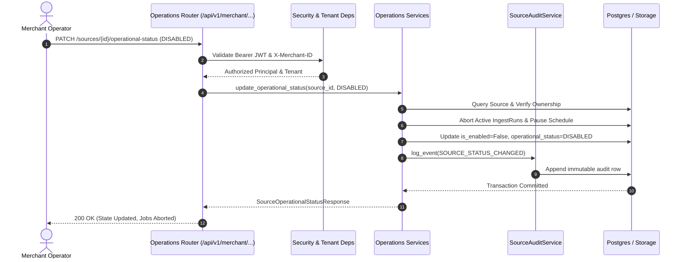

# Phase 05.6: Merchant Catalog Operations Architecture

## 1. Overview and Core Philosophy
Phase 05.6 delivers the operational control plane for FashXStudio catalog acquisition. While Phases 05.1 through 05.5 established source authorization, adapters, ingestion pipelines, image lifecycle management, and canonical database freshness, Phase 05.6 exposes these capabilities through secure, tenant-isolated operational workflows.

### Fundamental Operational Invariants
1. **Separation of Authorization vs. Operational State**:
   - `source_status` (Authorization State): Controlled exclusively by platform compliance and contractual evidence (`PENDING_REVIEW`, `AUTHORIZED`, `SUSPENDED`, `REVOKED`, `EXPIRED`).
   - `operational_status` / `is_enabled` (Operational State): Controlled by the merchant operator (`ENABLED`, `DISABLED`, `PAUSED`). A merchant cannot enable a source whose authorization is suspended or revoked.
2. **Strict Multi-Tenant Isolation**:
   - Merchants can only view and manage catalog sources, synchronization runs, quarantine errors, and product offers that belong directly to their merchant identity.
   - Cross-tenant modifications are strictly forbidden and rejected with `tenant_isolation_violation`.
3. **Canonical Garment Preservation**:
   - When a merchant removes or deactivates an offer, the underlying canonical garment is preserved if other merchants still offer that product.
4. **Non-Repudiation and Audit Logging**:
   - Every operational intervention (toggling source status, triggering sync, configuring schedules, overriding product fields, removing offers, takedowns) generates an immutable audit record in `catalog_source_audit_events`.
5. **Zero Credential Exposure**:
   - Secrets and tokens are referenced solely by vault identifiers (`secrets://...` or ARN) and masked in all operational responses and failure logs.

---

## 2. Operational Actors and Security Model

```mermaid
graph TD
    subgraph Platform Administration
        PA[Platform Admin] -->|Contract & License Clearance| SA[Source Authorization]
        PA -->|Emergency Legal Action| ST[Source Takedown]
        PA -->|Global Compliance Audits| GA[Full Audit Trail]
    end

    subgraph Merchant Operations
        MO[Merchant Operator] -->|Register & Connect| SC[Source Connection]
        MO -->|Toggle Operational State| SO[Enable/Disable Switch]
        MO -->|Run Ad-Hoc Ingestion| MS[Manual Sync Trigger]
        MO -->|Configure Frequency| SS[Schedule Manager]
        MO -->|Monitor Dashboard| SM[Sync & Health Status]
        MO -->|Remediate Failures| QR[Quarantine & Error Reports]
        MO -->|Inspect Rights| IP[Image Permission Matrix]
        MO -->|Manage Custom Data| PO[Product Field Overrides]
        MO -->|Deactivate Listings| OD[Offer Deactivation]
    end

    subgraph Database Boundary
        SC & SO & ST --> CS[(catalog_sources)]
        MS & SS --> CSR[(ingest_runs & schedules)]
        QR --> CIQ[(catalog_ingestion_quarantine)]
        IP --> CIA[(catalog_image_assets)]
        PO & OD --> MOF[(merchant_products & merchant_offers)]
        ALL_ACTIONS --> CSA[(catalog_source_audit_events)]
    end
```

---

## 3. Operational Domain Subsystems

| Workstream | Subsystem | Key Responsibilities |
| :--- | :--- | :--- |
| **5.6.1** | Source Connection Management | Registration, credential secret masking, adapter binding, authorization validation. |
| **5.6.2** | Source Lifecycle Controls | Operational state switching, graceful running job cancellation, schedule pausing. |
| **5.6.3** | Manual Synchronization | Idempotent on-demand sync triggering, mode specification, concurrent job rate-limiting. |
| **5.6.4** | Scheduled Synchronization | Cadence configuration, interval safety enforcement (>= 15 min), timezone & next-run calculation. |
| **5.6.5** | Sync Status & Monitoring | Real-time health metrics, run duration, ingestion counters (fetched, created, updated, quarantined). |
| **5.6.6** | Ingestion Failure Reporting | Structured error logs, retryable classification, automated credential & token redaction. |
| **5.6.7** | Product Rejection Reporting | Quarantined item discovery, validation failure analysis, automated remediation guidance. |
| **5.6.8** | Image Permission Dashboard | Multi-operation image rights evaluation (fetch, store, display, AI, VTO, derivatives). |
| **5.6.9** | Source Takedown Workflow | Emergency source suspension, cascading offer deactivation, image asset purging. |
| **5.6.10** | Merchant Product Updates | Field ownership separation (source-managed vs merchant-managed), override persistence. |
| **5.6.11** | Merchant Product Removal | Merchant offer deactivation while preserving shared multi-merchant canonical garments. |
| **5.6.12** | Operational Audit History | Immutable append-only operational audit logging with tenant-scoped retrieval. |

---

## 4. Architectural Boundaries and Component Interactions

