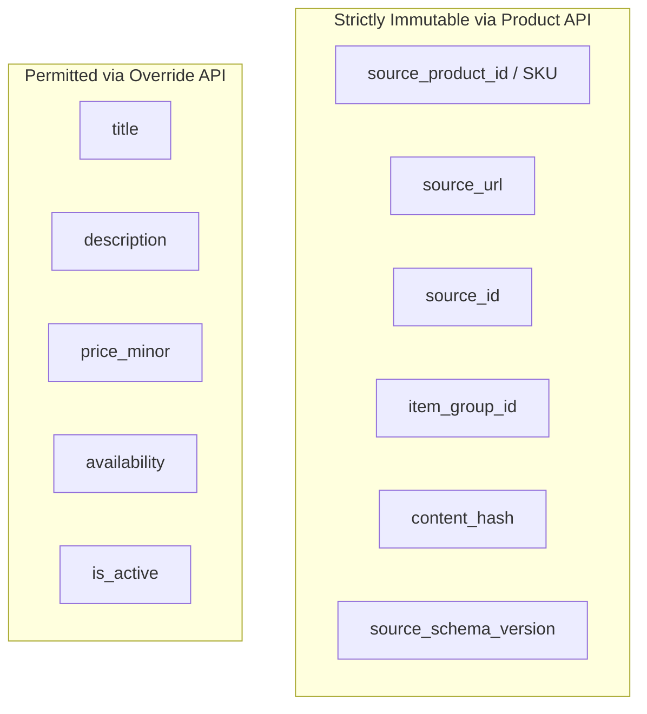

# Merchant Product Update Policy

## 1. Overview
FashXStudio distinguishes between product attributes managed by external source feeds and attributes that merchant operators are permitted to manually customize or override for marketing, merchandising, or pricing adjustments.

---

## 2. Field Ownership Boundaries

### Policy Rules
1. **Source-Managed Fields Cannot Be Overridden**:
   Attempts to override `source_product_id`, `source_url`, or feed identifiers fail with `field_override_disallowed`. These fields represent data provenance and can only change when the upstream source feed updates.
2. **Merchant-Managed Fields Persisted as Overrides**:
   Overrides are persisted in `merchant_product_overrides` and immediately propagated to `merchant_products`.
3. **Audit Trail**:
   Every override records the previous value, new value, operator identity, and mandatory reason in `catalog_source_audit_events`.
4. **Tenant Isolation**:
   Merchants can only override products where `merchant_product.merchant_id == current_merchant_id`. Cross-merchant modifications are rejected with `tenant_isolation_violation`.
