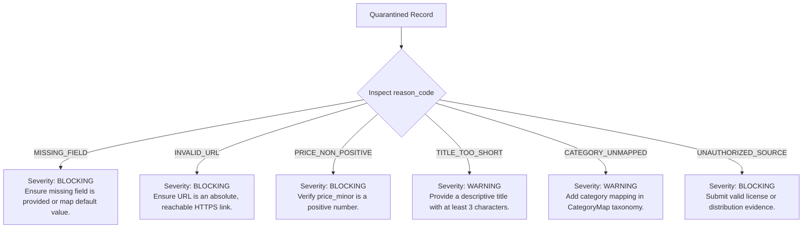

# Product Rejection and Quarantine Reporting

## 1. Overview
When a product record returned by an adapter fails schema validation, required field checks, taxonomy mapping, or price bounds, FashXStudio isolates it in `catalog_ingestion_quarantine`. The product rejection reporting subsystem enables merchant operators to discover, analyze, and remediate these quarantined records.

---

## 2. Automated Remediation Guidance Engine

Each quarantined product record is analyzed against known validation patterns to generate an actionable remediation hint:

---

## 3. Rejection Guidance Matrix

| Reason Code | Severity | Summary | Recommended Operator Action |
| :--- | :--- | :--- | :--- |
| **`MISSING_FIELD`** | `BLOCKING` | A mandatory product field is missing. | Ensure the missing field (e.g. brand, price, url) is provided in the feed or configure a default value. |
| **`INVALID_URL`** | `BLOCKING` | Product URL is invalid or insecure. | Ensure the product URL is a fully-qualified, reachable HTTPS link. |
| **`PRICE_NON_POSITIVE`**| `BLOCKING` | Price must be greater than zero. | Verify that `price_minor` is a positive number representing the retail price in minor currency units. |
| **`TITLE_TOO_SHORT`** | `WARNING` | Product title does not meet length criteria. | Provide a descriptive product title with at least 3 characters. |
| **`CATEGORY_UNMAPPED`**| `WARNING` | Source category does not match canonical taxonomy. | Add a taxonomy category mapping in `CategoryMap` or update the source feed category. |
| **`UNAUTHORIZED_SOURCE`**| `BLOCKING` | Source does not possess valid authorization evidence. | Submit current license or distribution agreement evidence to platform administration. |

---

## 4. Lifecycle of Quarantined Records
1. **`PENDING`**: Initial quarantine state upon ingestion rejection.
2. **`RESOLVED`**: Automatically transitioned to resolved when a subsequent sync run successfully processes the same product without validation errors.
3. **`IGNORED`**: Manually marked by an operator for products deliberately excluded from FashXStudio catalog.
