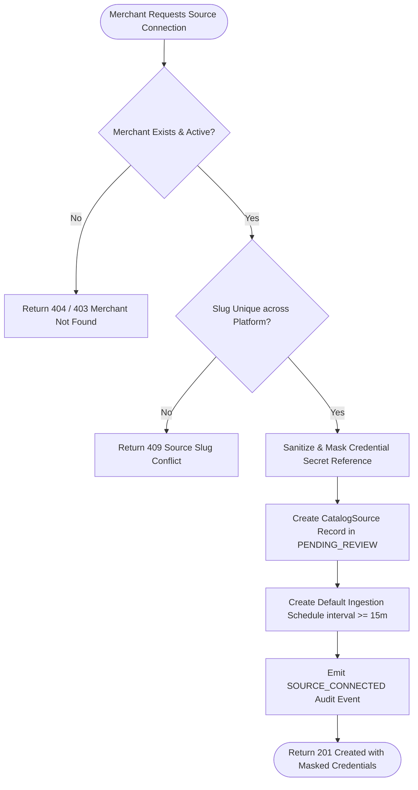

# Source Connection Management

## 1. Purpose and Scope
Source connection management allows authorized merchant operators to register, configure, and inspect connections between their external catalog feeds or APIs and FashXStudio's ingestion infrastructure.

---

## 2. Source Registration Flow

---

## 3. Credential Vaulting and Reference Masking

Plaintext API keys, OAuth tokens, and passwords must **never** be stored directly in `catalog_sources`. Sources reference credentials stored in AWS Secrets Manager, HashiCorp Vault, or encrypted local keystores using URI references:

- Standard URI: `secrets://fashx-prod/merchants/{merchant_slug}/{secret_name}`
- AWS ARN: `arn:aws:secretsmanager:ap-south-1:123456789012:secret:fashx/merchant/key-AbCdEf`

### Masking Rules
When returning source metadata through API endpoints or UI dashboards, credential references are masked to prevent accidental shoulder-surfing or leakage into client-side logging:
- For URIs: All path elements after the base namespace are masked (`secrets://fashx-prod/merchants/my-brand/******`).
- For ARNs: The resource suffix is truncated and masked (`arn:aws:secretsmanager:ap-south-1:123456789012:secret:******`).
- Raw token fallbacks: Masked completely to `******`.

---

## 4. Default State on Registration
1. `source_status`: Initialized to `PENDING_REVIEW`. Catalog ingestion will not publish products to shoppers until platform compliance marks the source as `AUTHORIZED`.
2. `operational_status`: Initialized to `ENABLED`. The merchant can trigger validation-only test runs immediately.
3. `is_enabled`: `True`.
4. `catalog_source_schedules`: Initialized with `enabled=True`, `interval_minutes=max(15, refresh_hours * 60)`, `sync_mode=INCREMENTAL`.

---

## 5. Security & Isolation Controls
- Only an administrator or a verified merchant operator of the target `merchant_id` can create or connect a source.
- Any attempt by Merchant A to pass Merchant B's `merchant_id` in the connection request triggers a `403 Forbidden` response.
