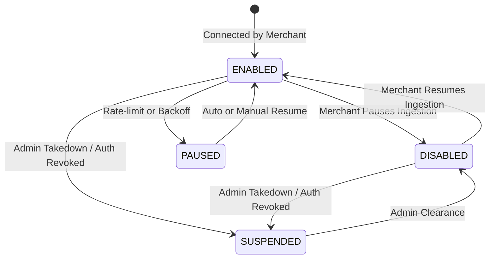

# Source Enable and Disable Policy

## 1. Objective
Establish unambiguous boundaries between a catalog source's legal/contractual authorization status and its day-to-day operational status.

---

## 2. State Distinction Matrix

| State Type | Attribute | Controlled By | Valid Values | Purpose |
| :--- | :--- | :--- | :--- | :--- |
| **Authorization State** | `source_status` | Platform Administration & Compliance | `PENDING_REVIEW`, `AUTHORIZED`, `SUSPENDED`, `REVOKED`, `EXPIRED` | Determines whether the source has legal permission to publish catalog products, download images, or permit virtual try-on. |
| **Operational State** | `operational_status` & `is_enabled` | Merchant Operator & Platform Administration | `ENABLED`, `DISABLED`, `PAUSED`, `SUSPENDED` | Determines whether automated jobs or manual sync runs may actively execute against the external source. |

---

## 3. State Transition Guardrails

### Critical Rules
1. **Authorization Overrides Operational Preference**:
   If `source_status` is `SUSPENDED` or `REVOKED`, the merchant **cannot** transition `operational_status` to `ENABLED`. The API rejects the request with `source_authorization_blocked`.
2. **Graceful Job Termination on Disable**:
   When a source is set to `DISABLED` or `PAUSED`:
   - All currently running, queued, or validating `IngestRun` jobs for that source are transitioned to `aborted`.
   - The job error is recorded with the operator's reason.
   - The synchronization schedule is marked `enabled=False`.
3. **Audit Trail**:
   All operational status transitions are recorded in `catalog_source_audit_events` with previous status, new status, and the mandatory reason provided by the operator.
