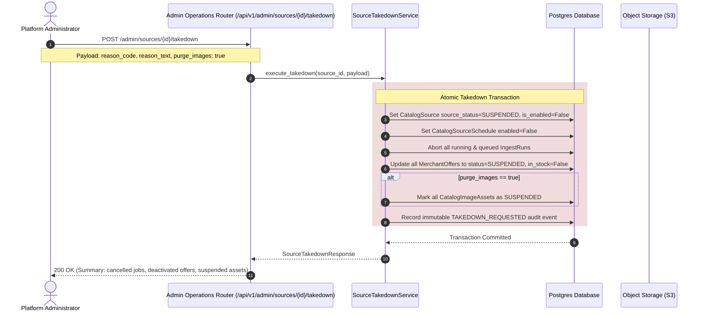

# Source Takedown Workflow

## 1. Overview and Operational Urgency
When a retailer partnership ends, licensing agreements expire, or a legal takedown notice is served, platform administrators must be able to immediately and atomically suspend a catalog source, cancel active jobs, deactivate public offers, and purge/suspend stored image assets.

---

## 2. Emergency Takedown Execution Flow

---

## 3. Cascading Effects
1. **Source State**:
   - `source_status = "SUSPENDED"`
   - `operational_status = "SUSPENDED"`
   - `is_enabled = False`
2. **Job Abort**:
   - Active `IngestRun` rows set to `status = "aborted"` with message noting the takedown reason code.
3. **Offer Inactivation**:
   - Every `MerchantOffer` linked to `source_id` is marked `status = "SUSPENDED"` and `in_stock = False`.
   - Offers are immediately removed from search indexes and shopper feeds.
4. **Image Asset Safeguard**:
   - If `purge_images: true`, all `CatalogImageAsset` records linked to `source_id` transition to `status = "SUSPENDED"`, preventing display CDN delivery and try-on synthesis.
5. **Canonical Garment Retention**:
   - Any canonical garment associated with the deactivated offers is evaluated: if other authorized merchants still sell that garment, the canonical garment remains active; otherwise it is marked inactive.
