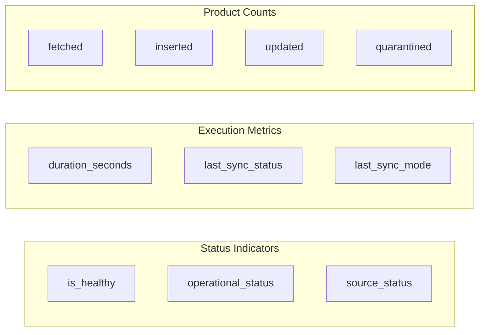

# Synchronization Status and Monitoring

## 1. Overview
The synchronization status dashboard (`GET /api/v1/merchant/sources/{id}/status`) aggregates operational metrics, ingestion throughput, execution duration, and health indicators for merchant operators and administrators.

---

## 2. Dashboard Metrics and Indicators

### Metrics Definition
1. **`is_healthy`**:
   - Evaluated as `True` if:
     - Source is enabled (`is_enabled == True`).
     - Authorization is valid (`source_status` is not `SUSPENDED` or `REVOKED`).
     - Last sync run completed successfully (`ok` or `completed`) or is currently in progress (`running`).
   - If the last run failed (`failed` or `aborted`), `is_healthy` returns `False`.
2. **`duration_seconds`**:
   - Elapsed wall-clock execution time calculated from `finished_at - started_at` on the latest `IngestRun`.
3. **Granular Counts**:
   - `fetched`: Total raw product records parsed from the source response/feed.
   - `inserted`: New products or offers added to FashXStudio catalog.
   - `updated`: Existing products whose price, title, or availability changed.
   - `quarantined`: Invalid records quarantined into `catalog_ingestion_quarantine`.
4. **`last_error`**:
   - Sanitized error message if the last run failed.

---

## 3. SLA & Operational Thresholds
- **Ingestion Duration**: Full runs exceeding 3,600 seconds trigger alert warnings.
- **Quarantine Ratio**: If `quarantined / fetched > 0.10` (more than 10% invalid records), the health dashboard surfaces a schema warning.
- **Freshness Warning**: If `current_time - last_successful_sync_at > source.freshness_policy_hours`, the source is marked as stale.
