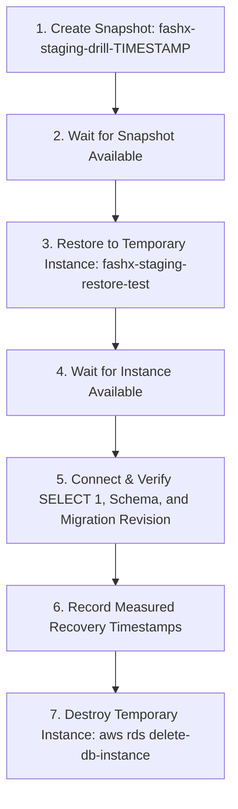

# Database Backup & Disaster Recovery Runbook

## 1. Overview & Disaster Recovery Objectives

This runbook defines the operational procedure for executing disaster recovery drills, verifying automated RDS PostgreSQL backups, and restoring staging or production databases in AWS Mumbai (`ap-south-1`).

### Recovery Objectives
- **Recovery Point Objective (RPO)**: < 5 minutes (via RDS continuous automated backups and transaction log retention).
- **Recovery Time Objective (RTO)**: < 30 minutes (from snapshot restoration initiation to application verification).

## 2. Disaster Recovery Rules

> [!CRITICAL]
> 1. **Never Overwrite the Active Database**: A backup restoration drill must always target a dedicated, separate instance identifier (`fashx-<env>-restore-test`).
> 2. **Object Storage (S3) Coupling**: Database records contain references to S3 object keys (`users/{user_id}/...`, `tryon/{job_id}/...`). Recovery procedures must confirm that media objects referenced in the restored database exist in S3.
> 3. **Clean Teardown**: Temporary restored instances incur compute and storage charges. They must be destroyed immediately after evidence collection.

## 3. Step-by-Step Restoration Drill Procedure



### Step 1: Create Manual Snapshot
```bash
SNAPSHOT_ID="fashx-staging-drill-$(date +%Y%m%d%H%M%S)"

aws rds create-db-snapshot \
  --db-instance-identifier fashx-pg-staging \
  --db-snapshot-identifier "$SNAPSHOT_ID" \
  --region ap-south-1

aws rds wait db-snapshot-available \
  --db-snapshot-identifier "$SNAPSHOT_ID" \
  --region ap-south-1
```

### Step 2: Restore Snapshot to Isolated Instance
```bash
RESTORE_INSTANCE="fashx-staging-restore-test"

aws rds restore-db-instance-from-db-snapshot \
  --db-instance-identifier "$RESTORE_INSTANCE" \
  --db-snapshot-identifier "$SNAPSHOT_ID" \
  --db-instance-class db.t4g.small \
  --publicly-accessible false \
  --region ap-south-1

aws rds wait db-instance-available \
  --db-instance-identifier "$RESTORE_INSTANCE" \
  --region ap-south-1
```

### Step 3: Verify Restored Database
Retrieve the temporary endpoint address:
```bash
RESTORE_ENDPOINT=$(aws rds describe-db-instances \
  --db-instance-identifier "$RESTORE_INSTANCE" \
  --region ap-south-1 \
  --query 'DBInstances[0].Endpoint.Address' \
  --output text)
```

Execute schema and integrity verification:
```bash
# Verify schema revision and tables
DATABASE_URL="postgresql+asyncpg://fashx_app:PASSWORD@${RESTORE_ENDPOINT}:5432/fashx_staging" \
python scripts/staging/validate_database.py --output-dir reports/staging
```

### Step 4: Record Recovery Measurements
Record the following metrics:
- Snapshot creation start time: `<UTC timestamp>`
- Snapshot available time: `<UTC timestamp>`
- Restore start time: `<UTC timestamp>`
- Restored instance available time: `<UTC timestamp>`
- Verification completed time: `<UTC timestamp>`
- Total Measured Recovery Time (RTO): `<duration in seconds>`

### Step 5: Teardown Temporary Restored Instance
```bash
aws rds delete-db-instance \
  --db-instance-identifier "$RESTORE_INSTANCE" \
  --skip-final-snapshot \
  --region ap-south-1
```

## 4. Automated Execution Script

The entire drill procedure is automated by the shell script:
```bash
bash infra/aws/scripts/backup_restore_test.sh staging
```
