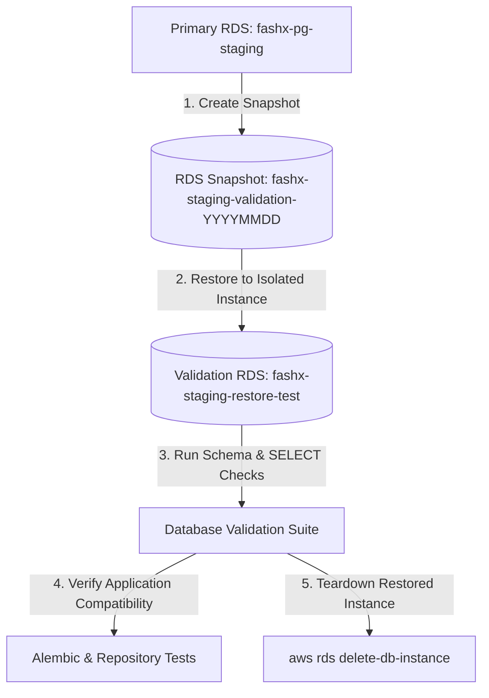

# Database Backup & Disaster Recovery Validation

## 1. Overview

A configured backup schedule does not prove disaster recovery capability. Backup and restore validation proves that the staging PostgreSQL database (`fashx-pg-staging`) can be restored from an automated or manual AWS RDS snapshot to an isolated validation instance, with full schema and data integrity verified.

Verification is executed via `scripts/staging/validate_backup_restore.py`.

## 2. Disaster Recovery Architecture



## 3. Mandatory Recovery Requirements

1. **Isolation Rule**: A restore test must never overwrite the running staging or production database. The snapshot must be restored to a dedicated, temporary instance identifier (`fashx-staging-restore-test`).
2. **Storage Coupling (DB + S3)**: PostgreSQL records reference object storage keys in Amazon S3 (`users/{user_id}/...`, `tryon/{job_id}/...`). A complete disaster recovery drill must verify that media objects referenced in the restored database remain accessible in S3.
3. **Recovery Time Objective (RTO)**: Total time from snapshot restore initiation to application readiness must be recorded (Target: < 30 minutes for staging).
4. **Recovery Point Objective (RPO)**: RDS continuous automated backups provide Point-In-Time Recovery (PITR) with an RPO target of < 5 minutes.

## 4. Execution Commands

### Configuration Policy Verification
```bash
python scripts/staging/validate_backup_restore.py --output-dir reports/staging
```

### End-to-End Live AWS Drill Commands (Founder Execution)
```bash
# 1. Create snapshot
aws rds create-db-snapshot \
  --db-instance-identifier fashx-pg-staging \
  --db-snapshot-identifier "fashx-staging-drill-$(date +%Y%m%d%H%M)" \
  --region ap-south-1

# 2. Wait for snapshot availability
aws rds wait db-snapshot-available \
  --db-snapshot-identifier "fashx-staging-drill-$(date +%Y%m%d%H%M)" \
  --region ap-south-1

# 3. Restore to temporary test instance
aws rds restore-db-instance-from-db-snapshot \
  --db-instance-identifier fashx-staging-restore-test \
  --db-snapshot-identifier "fashx-staging-drill-$(date +%Y%m%d%H%M)" \
  --db-instance-class db.t4g.small \
  --region ap-south-1

# 4. Wait for restored instance
aws rds wait db-instance-available \
  --db-instance-identifier fashx-staging-restore-test \
  --region ap-south-1

# 5. Clean up temporary restored instance
aws rds delete-db-instance \
  --db-instance-identifier fashx-staging-restore-test \
  --skip-final-snapshot \
  --region ap-south-1
```

## 5. Acceptance Criteria

- Snapshot creation and restore complete with exit code 0.
- Restored database contains expected tables and matches Alembic migration revision.
- S3 object coupling is confirmed intact.
- Temporary restored instance is cleanly terminated post-verification.
