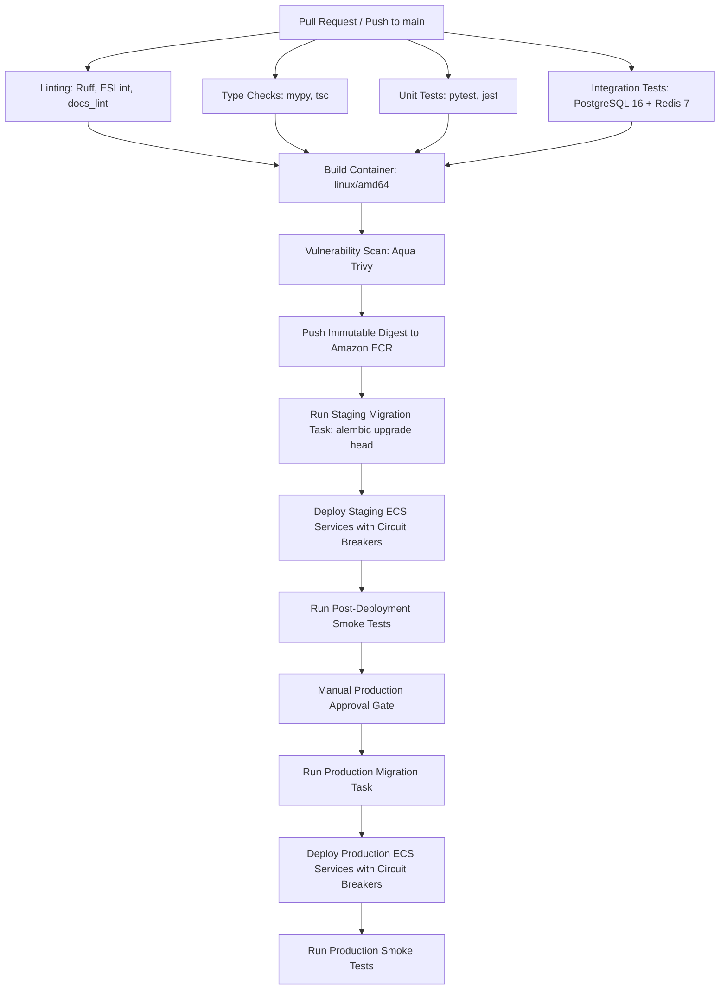

# CI/CD Pipeline Architecture Specification

## 1. Executive Summary

FashXStudio implements a continuous integration and continuous deployment (CI/CD) pipeline on GitHub Actions, targeting Amazon ECR and Amazon ECS Fargate in AWS Mumbai (`ap-south-1`).

The pipeline enforces immutable container promotion: a container image is built and vulnerability-scanned once from `main`, referenced strictly by cryptographic digest (`sha256:...`), verified on staging, and promoted to production without rebuilding.

## 2. Pipeline Quality Gates & Security Controls

| Stage | Tool / Runner | Success Criteria | Failure Action |
| :--- | :--- | :--- | :--- |
| **Linting** | `ruff`, `eslint`, `docs_lint.py` | 0 errors, 0 warnings | Fails pull request check. |
| **Type Checking** | `mypy`, `npx tsc --noEmit` | Strict typing passes | Fails pull request check. |
| **Unit Tests** | `pytest -m "not frozen and not integration"` | 100% pass | Fails pull request check. |
| **Integration Tests**| Postgres 16 (`pgvector`) + Redis 7 containers | 100% pass | Fails pull request check. |
| **Vulnerability Scan**| Aqua Security Trivy | 0 HIGH or CRITICAL unfixed CVEs | Blocks ECR push / deployment. |
| **Migration Check** | Alembic single-head validation | Exactly 1 head, 0 drift | Blocks container deployment. |
| **OIDC Authentication**| AWS OIDC (`aws-actions/configure-aws-credentials`) | Temporary STS tokens | No static AWS keys in repo secrets. |
| **Smoke Verification**| `scripts/release/smoke.py` | Liveness & readiness 200 OK | Triggers automated ECS rollback. |

## 3. Workflows Inventory

1. `.github/workflows/ci.yml`: Executes linting, static type checking, unit tests, integration tests, and migration checks on all pull requests and pushes to `main`.
2. `.github/workflows/deploy-staging.yml`: Triggers on successful completion of `ci.yml` on `main`. Builds image, scans with Trivy, pushes immutable digest, executes one-off migration task, deploys ECS staging services with circuit breakers, and runs smoke verification.
3. `.github/workflows/deploy-production.yml`: Triggers via `workflow_dispatch` requiring explicit `image_digest` input. Protected by GitHub Environment manual approval rules.
4. `.github/workflows/staging-validation.yml`: Triggers on completion of `deploy-staging.yml` or manual dispatch. Executes full Phase 03.7 diagnostic test suite.
5. `.github/workflows/infrastructure-validation.yml`: Validates Terraform formatting, ECS task definition JSON schemas, and IAM policies.
