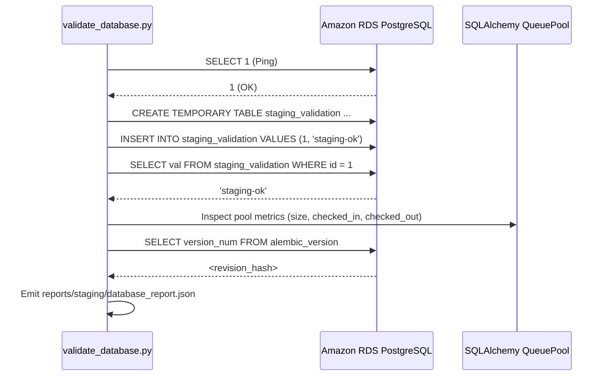

# Database Deployment Validation — PostgreSQL 16 (RDS)

## 1. Overview

Database validation verifies that the deployed API and worker services on ECS Fargate can securely authenticate, execute transactional queries, maintain connection pool health, and match the target schema revision on the managed PostgreSQL instance `fashx-pg-staging` in AWS Mumbai (`ap-south-1`).

Verification is performed via `scripts/staging/validate_database.py`.

## 2. Validation Test Procedure



## 3. Core Verification Steps

### Step 1: Network & TLS Verification
- Verify that the RDS instance is provisioned in private application subnets.
- Verify security group rules: ingress allowed on port 5432 exclusively from the API and worker ECS security groups.
- Verify TLS configuration (`ssl=True` with AWS RDS root certificate bundle).

### Step 2: Database Connectivity & Read/Write Test
- Execute non-destructive `SELECT 1` ping.
- Create an ephemeral temporary table `staging_validation` to prove write and read capability without polluting permanent application tables.
- Drop temporary table upon test exit.

### Step 3: Connection Pool Inspection
- Call `get_db_pool_metrics()` to confirm that connection pooling is active:
  - `size`: Configured persistent pool limit (e.g. 10).
  - `checked_in`: Idle available connections.
  - `checked_out`: Actively leased connections.
  - `overflow`: Connections allocated beyond base pool size.

### Step 4: Schema Revision State
- Query `SELECT version_num FROM alembic_version` and confirm that it matches the latest migration head in `alembic/versions/`.

## 4. Execution Commands

```bash
# Execute database validation
python scripts/staging/validate_database.py --output-dir reports/staging
```

### Expected Output
```text
[*] Running database validation suite...
[*] Database validation complete. Status: PASS
[*] Report saved to reports/staging/database_report.json
```

## 5. Security & Isolation Safeguards

- Database credentials are retrieved from AWS Secrets Manager and never logged or printed to stdout.
- Database URLs are sanitized using `scrub()` before serializing to report files.
- All transactional tests utilize session-scoped temporary tables or read-only queries.
