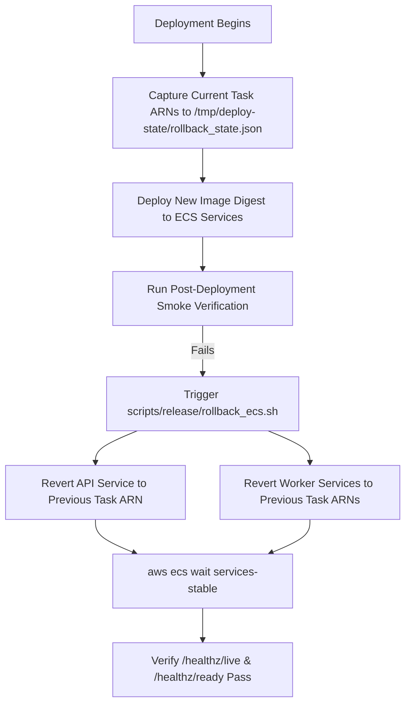

# Deployment Rollback Runbook & Safety Procedure

## 1. Overview

Deployment rollback readiness guarantees that if an updated container release introduces a defect, latency spike, or health check failure in staging or production, the environment can be reliably reverted to the previous healthy task definition revision within minutes.

Rollback automation is provided by `scripts/release/rollback_ecs.sh` and verified via `scripts/staging/validate_rollback.py`.

## 2. Rollback Execution Architecture



## 3. Rollback State Payload Specification

Before updating any ECS service, the deployment workflow captures the active task definition ARNs into `/tmp/deploy-state/rollback_state.json`:

```json
{
  "fashx-staging-api": "arn:aws:ecs:ap-south-1:123456789012:task-definition/fashx-staging-api:42",
  "fashx-staging-tryon": "arn:aws:ecs:ap-south-1:123456789012:task-definition/fashx-staging-tryon:38",
  "fashx-staging-ingest": "arn:aws:ecs:ap-south-1:123456789012:task-definition/fashx-staging-ingest:35",
  "fashx-staging-beat": "arn:aws:ecs:ap-south-1:123456789012:task-definition/fashx-staging-beat:29"
}
```

## 4. Critical Database Rollback Rule

> [!CAUTION]
> **Application rollback is strictly separated from database rollback.**
> If an Alembic migration has already run, an application container rollback must NOT automatically execute `alembic downgrade -1`.
> 1. All database migrations must follow backward-compatible expand/contract patterns so previous application releases continue to operate cleanly on the new schema.
> 2. Database rollbacks for destructive schema bugs require explicit manual DBA review and snapshot restoration if necessary.

## 5. Execution Commands

### Rollback Readiness Validation
```bash
python scripts/staging/validate_rollback.py --output-dir reports/staging
```

### Manual Rollback Execution
```bash
# Execute rollback script for staging environment
bash scripts/release/rollback_ecs.sh staging /tmp/deploy-state/rollback_state.json
```

## 6. Acceptance Criteria

- Rollback script successfully updates all specified ECS services to their previous task definition ARNs.
- `aws ecs wait services-stable` confirms all tasks stabilize.
- Restored API passes `/healthz/live` and `/healthz/ready`.
- Previous image digest is active on all running containers.
