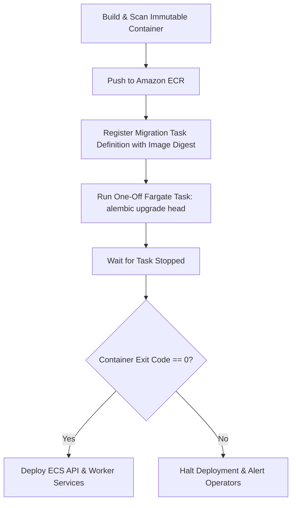

# Database Migration Pipeline Validation — Alembic

## 1. Overview

Database migration validation proves that Alembic schema migrations can safely transition the staging database from its current revision to the release revision without data loss, downtime, or unapplied heads.

Migrations in staging and production are never executed inside long-running API web containers. Instead, they run as an isolated one-off ECS Fargate task prior to service deployment.

Verification is executed via `scripts/staging/validate_migrations.py`.

## 2. Migration Execution Sequence



## 3. Core Safety & Governance Rules

1. **One-Off Task Execution**: Database migrations run exactly once per deployment via `infra/aws/ecs/task-definitions/migration-staging.json`.
2. **Single Migration Head**: Branches and releases must enforce a single Alembic head (`len(script.get_heads()) == 1`). Multiple heads block the deployment pipeline.
3. **Schema Drift Detection**: The pipeline executes `alembic check` to detect differences between SQLAlchemy models and the database schema.
4. **Expand / Contract Pattern**: Potentially breaking changes (such as column renames or table splits) must follow multi-phase expand/contract patterns so running API containers remain compatible during rolling deployments.
5. **No Automatic Downgrade on Rollback**: Application rollback restores previous container images but does not automatically execute `alembic downgrade -1`.

## 4. Execution Commands

```bash
# Execute migration state validation
python scripts/staging/validate_migrations.py --output-dir reports/staging
```

### Expected Output
```text
[*] Validating database migrations...
[*] Migration validation complete. Status: PASS
[*] Report saved to reports/staging/migration_report.json
```

## 5. Acceptance Criteria

- Migration task uses the exact release image digest.
- Container exits with code 0.
- Database revision in `alembic_version` matches the single target migration head.
- `alembic check` reports no unhandled schema drift.
