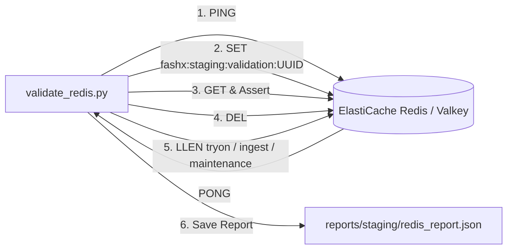

# Redis & Queue Broker Deployment Validation

## 1. Overview

FashXStudio uses Amazon ElastiCache for Valkey / Redis 7.2 as the Celery asynchronous task broker in the AWS Mumbai region (`ap-south-1`).

Deployment validation verifies network connectivity, authentication, TLS encryption, ephemeral key operations, and queue structure integrity via `scripts/staging/validate_redis.py`.

## 2. Validation Procedure



## 3. Verified Capabilities

1. **Broker Connectivity**: Validates low-latency PING round-trip (target < 5ms within VPC).
2. **Key Operations**: Sets an ephemeral key with 60-second TTL (`fashx:staging:validation:<uuid>`), verifies the value, and deletes the key.
3. **Celery Queue Structure**: Inspects list lengths (`LLEN`) for all configured Celery queues:
   - `tryon`: Virtual try-on inference and polling tasks.
   - `ingest`: Merchant catalog ingestion and vectorization tasks.
   - `maintenance`: Media retention, outbox sweeps, and cleanup jobs.
4. **Eviction Prevention**: Asserts that `maxmemory-policy` is configured to `noeviction` or `volatile-lru` to protect queued jobs from silent deletion.

## 4. Execution Commands

```bash
# Execute Redis validation
python scripts/staging/validate_redis.py --output-dir reports/staging
```

### Expected Output
```text
[*] Running Redis validation suite...
[*] Redis validation complete. Status: PASS
[*] Report saved to reports/staging/redis_report.json
```

## 5. Security & Isolation Safeguards

- Redis authentication token (AUTH) is injected from AWS Secrets Manager.
- Connection strings (`rediss://...`) are scrubbed before generating reports.
- All validation keys are namespaced with UUIDs and automatically expired with strict TTLs.
