# Service Restart & Resilience Validation

## 1. Overview

Service restart validation proves that FashXStudio services on ECS Fargate can gracefully handle container terminations, task replacements, and underlying infrastructure interruptions without permanent job loss or unhandled database corruptions.

Verification is executed via `scripts/staging/validate_restart.py`.

## 2. Tested Resilience Scenarios

```mermaid
flowchart TD
    subgraph Scenario A: API Task Replacement
        A1[API Task 1 Receives Traffic] --> A2[Controlled Task Stop: aws ecs stop-task]
        A2 --> A3[ALB Drains Connections]
        A3 --> A4[ECS Launches Replacement Task]
        A4 --> A5[New Task Passes Health Checks]
        A5 --> A6[ALB Returns Healthy Target]
    end

    subgraph Scenario B: Worker Interruption & Recovery
        B1[Celery Worker Processes In-Flight Job] --> B2[Worker Receives SIGTERM from ECS]
        B2 --> B3[Warm Shutdown: Finish In-Flight within 90s]
        B3 -->|If Timeout Exceeded| B4[SIGKILL & Task Termination]
        B4 --> B5[Unacknowledged Job Re-Enqueued in Redis]
        B5 --> B6[Healthy Worker Picks Up Task via Late Acks]
    end
```



## 3. Resilience Configuration Verification

1. **Celery Late Acknowledgement (`task_acks_late = True`)**: Tasks are acknowledged only after successful completion. If a worker container crashes or is abruptly terminated mid-execution, the task remains in the Redis queue for redelivery.
2. **Worker Lost Rejection (`task_reject_on_worker_lost = True`)**: If a worker process exits abruptly (e.g. OOM killer), Celery re-queues the message rather than dropping it.
3. **Soft Shutdown Timeout (`worker_soft_shutdown_timeout = 90.0`)**: Upon receiving `SIGTERM` during ECS deployments, workers stop consuming new jobs and are given 90 seconds to complete active try-on or catalog tasks.
4. **Idempotency Guarantees**: Background operations are written with idempotent database upserts so that task re-execution does not produce duplicate database records.

## 4. Execution Commands

```bash
# Execute restart configuration validation
python scripts/staging/validate_restart.py --output-dir reports/staging
```

### Expected Output
```text
[*] Validating service restart and recovery configurations...
[*] Restart validation complete. Status: PASS
[*] Report saved to reports/staging/restart_report.json
```

## 5. Controlled Manual Restart Test (On-Demand)

```bash
# Obtain current staging task ARN
TASK_ARN=$(aws ecs list-tasks --cluster fashx-staging --service-name fashx-staging-api --query 'taskArns[0]' --output text)

# Stop task to trigger ECS replacement
aws ecs stop-task --cluster fashx-staging --task "$TASK_ARN" --reason "Controlled restart test"

# Wait for ECS service to stabilize
aws ecs wait services-stable --cluster fashx-staging --services fashx-staging-api

# Confirm replacement task is healthy
python scripts/staging/validate_deployment.py
```
