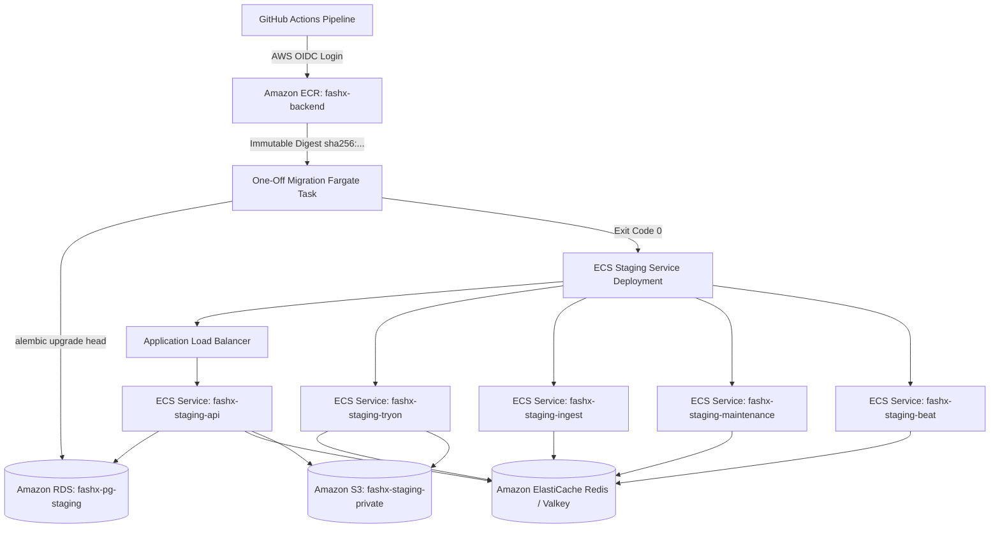

# Staging Deployment Validation Specification

## 1. Executive Summary

Phase 03.7 establishes the deployment validation framework for FashXStudio on AWS staging in the Mumbai region (`ap-south-1`).

Deployment validation verifies that the application is fully operational after container promotion—not merely that an ECS container started without crashing. Validation covers the API gateway, background workers, PostgreSQL database, Redis queues, Amazon S3 storage, logging, restart recovery, backup restoration, and rollback readiness.

## 2. Staging Infrastructure Architecture

## 3. Staging Resource Inventory

| Component | Staging Resource Identifier | Platform / Engine | Purpose |
| :--- | :--- | :--- | :--- |
| **ECS Cluster** | `fashx-staging` | AWS ECS Fargate | Serverless container execution cluster. |
| **API Service** | `fashx-staging-api` | FastAPI / Uvicorn | Public REST API gateway behind ALB. |
| **Try-On Worker** | `fashx-staging-tryon` | Celery Worker | Asynchronous VTO inference dispatch & polling. |
| **Ingestion Worker** | `fashx-staging-ingest` | Celery Worker | Catalog feed processing and vector embeddings. |
| **Maintenance Worker** | `fashx-staging-maintenance` | Celery Worker | Outbox event relay and media erasure sweeps. |
| **Beat Scheduler** | `fashx-staging-beat` | Celery Beat | Periodic scheduled maintenance coordinator. |
| **Database** | `fashx-pg-staging` | PostgreSQL 16 (RDS) | Primary transactional database. |
| **Job Broker** | ElastiCache Valkey Cluster | Redis 7.2 compatible | Asynchronous task queue broker. |
| **Object Storage** | `fashx-staging-private-<ACCOUNT_ID>` | Amazon S3 | Private media, try-on outputs, and feeds. |
| **Container Registry**| `fashx-backend` | Amazon ECR (`ap-south-1`) | Immutable container image repository. |
| **Log Group** | `/ecs/fashx/staging` | CloudWatch Logs | Centralized JSON application logs. |

## 4. Immutable Image Deployment Standards

1. **Digest Promotion**: Mutable tags (`latest`, `staging`) are strictly prohibited in ECS task definitions. Releases must reference the exact SHA-256 container digest (`fashx-backend@sha256:...`).
2. **Explicit Task Registration**: Deployment workflows must dynamically render and register a new ECS task definition revision containing the target image digest prior to calling `aws ecs update-service`.
3. **Deployment Circuit Breaker**: All staging services enable `deploymentCircuitBreaker={enable=true,rollback=true}` with `minimumHealthyPercent=100` and `maximumPercent=200`.

## 5. Pre-Deployment Verification Checklist

- [ ] Approved Git commit SHA verified on branch.
- [ ] Working tree clean without uncommitted changes.
- [ ] CI quality gates passed (linting, typing, unit tests, integration tests).
- [ ] Container image built, scanned with Trivy, and pushed to ECR.
- [ ] Secrets injected via AWS Secrets Manager (never hardcoded in task definitions).
- [ ] Application security groups permit egress to RDS (TCP 5432) and Redis (TCP 6379).
- [ ] S3 task role scoped strictly to the staging bucket.
