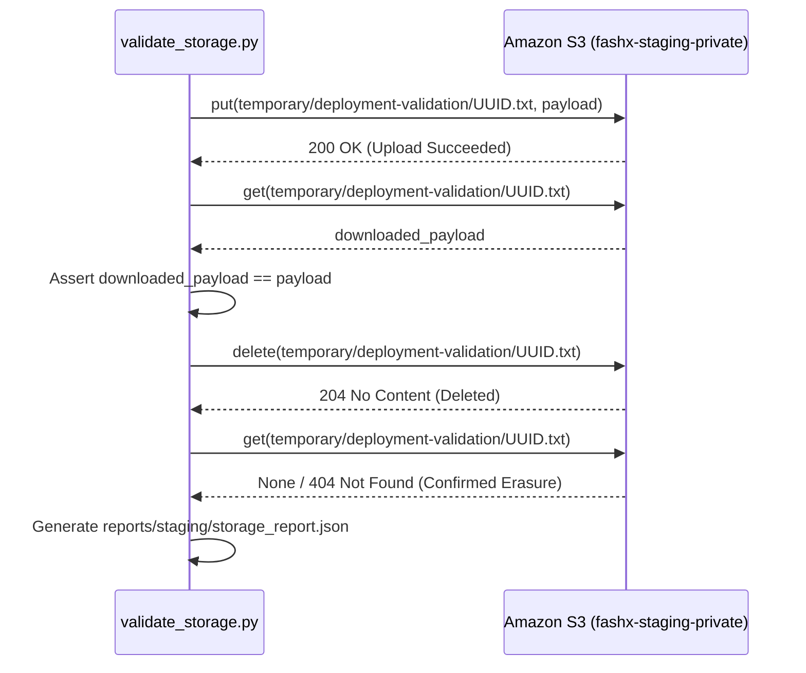

# Object Storage Deployment Validation — Amazon S3

## 1. Overview

Object storage validation verifies that the staging ECS services can interact with the private Amazon S3 bucket (`fashx-staging-private-<ACCOUNT_ID>`) using AWS IAM task roles, and that bucket privacy and encryption rules are strictly maintained.

Verification is executed via `scripts/staging/validate_storage.py`.

## 2. Validation Procedure



## 3. Verified Security & Functional Controls

1. **IAM Role Assumption**: S3 access uses the ECS task role (`S3_USE_IAM_ROLE=true`). No static AWS access keys or secret keys are configured in application environment variables.
2. **Round-Trip Upload, Download, and Delete**: Uploads a test payload, verifies binary integrity, deletes the object, and confirms it no longer exists.
3. **Public Access Block**: Confirms all four S3 Public Access Block settings are enabled on the bucket:
   - `BlockPublicAcls: true`
   - `IgnorePublicAcls: true`
   - `BlockPublicPolicy: true`
   - `RestrictPublicBuckets: true`
4. **Server-Side Encryption**: Bucket utilizes default AWS KMS or S3-managed encryption (`aws:kms` or `AES256`).
5. **Cross-Environment Denial**: Negative tests confirm that staging credentials cannot read or write to production S3 buckets (`fashx-prod-private-*`).

## 4. Execution Commands

```bash
# Execute storage validation
python scripts/staging/validate_storage.py --output-dir reports/staging
```

### Expected Output
```text
[*] Validating storage adapter (s3)...
[*] Storage validation complete. Status: PASS
[*] Report saved to reports/staging/storage_report.json
```

## 5. Privacy Safeguards

- Presigned URLs and S3 object keys are never logged.
- Only ephemeral validation objects under `temporary/deployment-validation/` are written and deleted during testing.
- No user profile images, selfies, or customer data are touched during deployment validation.
