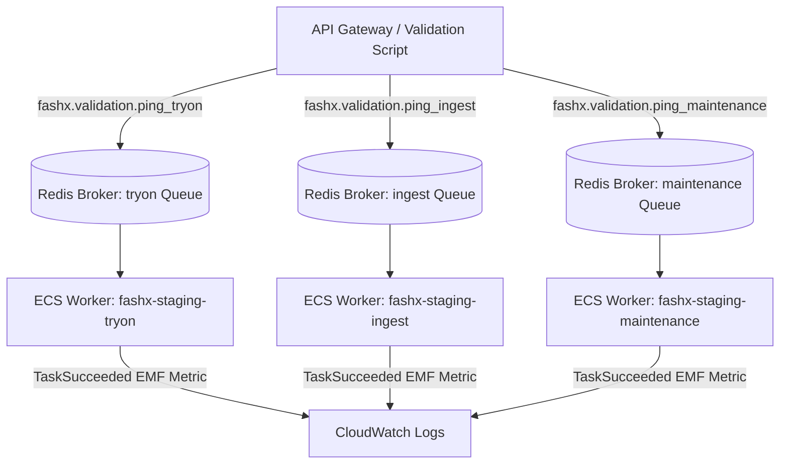

# Background Worker Pipeline Validation — Celery & ECS

## 1. Overview

FashXStudio deploys asynchronous Celery workers across three specialized ECS services:
- `fashx-staging-tryon`: Virtual try-on inference dispatch, status polling, and compositing.
- `fashx-staging-ingest`: Merchant catalog feed ingestion and image vectorization.
- `fashx-staging-maintenance`: Storage erasure sweeps, outbox event relays, and retention.

Worker validation verifies that real tasks are published, routed to the correct queue, executed by the designated worker, retried on transient errors, and routed to dead-letter queues upon permanent failure.

Verification is executed via `scripts/staging/validate_workers.py`.

## 2. Worker Diagnostic Task Catalog

Tasks are declared in `backend/fashx/workers/validation_tasks.py`:

| Task Name | Queue | Retry Policy | Purpose |
| :--- | :--- | :--- | :--- |
| `fashx.validation.ping` | Default | None | General worker vitality verification. |
| `fashx.validation.ping_tryon` | `tryon` | None | Verifies try-on worker queue processing. |
| `fashx.validation.ping_ingest` | `ingest` | None | Verifies ingest worker queue processing. |
| `fashx.validation.ping_maintenance` | `maintenance`| None | Verifies maintenance worker queue processing. |
| `fashx.validation.retryable` | `maintenance`| 3 retries | Verifies bounded retry behavior and backoff. |
| `fashx.validation.fatal` | `maintenance`| 0 retries | Verifies dead-letter failure handling. |

## 3. Worker Execution Flow



## 4. Execution Commands

```bash
# Execute background worker validation
python scripts/staging/validate_workers.py --output-dir reports/staging
```

### Expected Output
```text
[*] Running background worker validation suite...
[*] Worker validation complete. Status: PASS
[*] Report saved to reports/staging/worker_report.json
```

## 5. Acceptance Criteria

- All three worker ECS services are running with desired count = running count.
- Diagnostic tasks are acknowledged, executed, and completed.
- Queues reflect zero unacknowledged backlogs after task completion.
- Celery task signals emit `TaskStarted`, `TaskDuration`, and `TaskSucceeded` EMF metrics.
