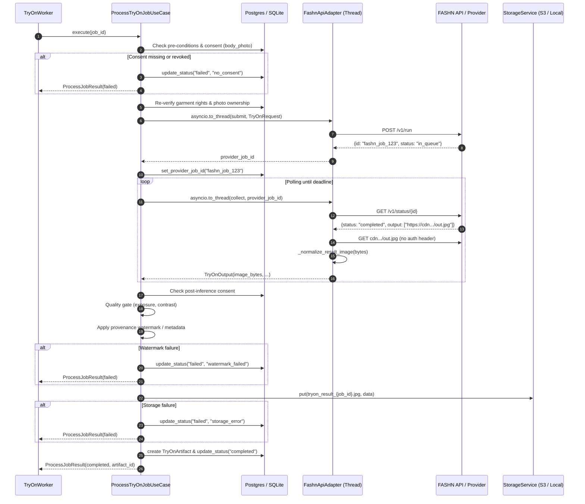

# VTO Phase 5 — Real AI Provider Integration & Inference Execution

**Project:** FashXStudio
**Phase:** VTO-5
**Status:** Implementation specification
**Objective:** Connect FashXStudio's asynchronous virtual try-on workflow to real AI try-on providers (hosted FASHN API and mock/self-hosted backends) with non-blocking execution off the asyncio event loop, rigorous image output normalization, fail-closed consent validation, configurable timeout propagation, and strict failure containment.

---

## 1. Scope & System Boundaries

Phase 5 hardens and integrates the provider inference execution layer within FashXStudio's asynchronous worker pipeline (`ProcessTryOnJobUseCase`):

### Included:
1. **Non-Blocking Thread Offloading:**
   - Both synchronous adapter invocations (`adapter.submit` and `adapter.collect`) and `FashnApiAdapter.execute_tryon` are executed off the asyncio event loop using `asyncio.to_thread`.
   - Eliminates event loop starvation during network I/O, polling loops, or CPU-bound decoding.

2. **Output Image Normalization & Quality Gate:**
   - Provider output bytes are inspected and normalized via `_normalize_result_image`:
     - Decodability verification using PIL.
     - Supported source formats: `JPEG`, `PNG`, `WEBP`.
     - Minimum resolution guard: rejects results with width < 256 or height < 256.
     - Maximum pixel safety limit: rejects results exceeding 25,000,000 pixels.
     - High-resolution downscaling: images exceeding `max_side=4096` are downscaled via `Image.Resampling.LANCZOS` preserving aspect ratio.
     - Color space normalization: converts `RGBA`, `LA`, `P` to standard `RGB` on solid white background.
     - Re-encoded as standard baseline JPEG (`quality=95`).
   - Post-inference quality check evaluates exposure and contrast heuristics before artifact publishing.

3. **Provider State Transition & Error Hardening:**
   - Explicit recognition of valid terminal statuses (`completed`, `failed`, `canceled`, `cancelled`).
   - Rejection of unknown or malformed provider statuses with `TryOnError("provider_invalid_status")`.
   - Preservation of `provider_job_id` during retryable polling intervals (`in_queue`, `processing`) with `clear_provider_job=False`.

4. **Configurable Timeout Propagation:**
   - `PlatformSettings.tryon_timeout_s` (default 90.0s) propagated from dependency injection factory `get_tryon_adapter()` to `FashnApiAdapter(..., timeout_s=...)`.
   - Dynamic resolution of adapter timeout within `ProcessTryOnJobUseCase` honoring configured deadlines.

5. **Strict Failure Containment & Provenance:**
   - Watermarking failures explicitly transition job to `failed` with `failure_reason="watermark_failed"`; no unwatermarked artifact is ever published.
   - Storage upload exceptions catch and transition job to `failed` with `failure_reason="storage_error"` without publishing artifact records.
   - Multi-checkpoint consent verification: if user consent is revoked before inference, during inference collection, or prior to storage write, generated outputs are discarded immediately.

### Excluded:
- Direct vendor billing or live commercial GPU payment charges in local automated test runs (verified via contract mocking and test fixtures).
- Multi-garment styling composition (Phase 6).
- Garment sizing and fit analysis (Phase 7).

---

## 2. Architecture & Data Flow

---

## 3. Provider State & Error Taxonomy

| Provider / Step Condition | System Behavior | Job Status | Failure Reason |
|---|---|---|---|
| `status == "in_queue" \| "processing"` | Requeue job for next polling cycle | `queued` | `None` (provider_job_id preserved) |
| Polling deadline exceeded | Requeue job for retry | `queued` | `None` (provider_job_id preserved) |
| `status == "failed"` | Permanent provider failure | `failed` | `provider_failed: <error>` |
| `status == "canceled" \| "cancelled"` | Provider canceled request | `failed` | `provider_cancelled` |
| Unknown provider status | Reject malformed response | `failed` | `provider_invalid_status` |
| Result image < 256x256 or corrupt | Reject unrenderable image | `failed` | `provider_bad_image` |
| Image > 4096px on any side | Lanczos downscale to 4096px max side | Continues | N/A |
| Watermarking engine error | Fail closed without publication | `failed` | `watermark_failed` |
| Storage upload error | Fail closed without publication | `failed` | `storage_error` |
| User revokes consent mid-flight | Discard output bytes immediately | `failed` | `consent_revoked` |

---

## 4. Verification & Testing Matrix

The implementation is verified by two test suites:

1. **`tests/unit/test_tryon_adapters.py` (14 unit tests)**:
   - Mock and commercial adapter interface compliance.
   - API key validation and production environment fail-closed guards.
   - SSRF protection against unauthorized CDN redirect hosts.
   - Image normalization: JPEG return, empty byte rejection, unsupported format rejection, min resolution enforcement, and high-res Lanczos downscaling.
   - Unknown provider status rejection.
   - Non-blocking thread execution off the event loop.

2. **`tests/unit/test_vto_provider_integration.py` (8 integration tests)**:
   - Persistence of `provider_job_id` before collection begins.
   - Requeuing on collection timeout preserving `provider_job_id`.
   - Handling of permanent provider failures.
   - Rejection of invalid provider images without artifact creation.
   - Safe failure containment on watermarking failure.
   - Immediate output disposal on mid-inference consent revocation.
   - Safe failure containment on storage upload failure.
   - Full end-to-end happy path with quality gate validation and artifact creation.
