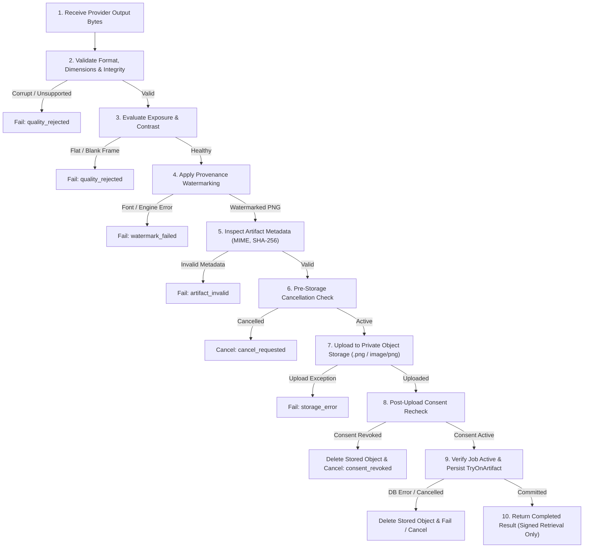

# VTO Phase 6 — Result Validation, Quality Evaluation & Secure Artifact Management

**Project:** FashXStudio  
**Phase:** VTO 6  
**Status:** Implementation specification  
**Prerequisite:** VTO Phase 5 — AI Provider Integration  

---

## 1. Objective

Ensure that AI-generated virtual try-on images are validated, quality-checked, watermarked, privately stored, and correctly associated with their originating user, photo, garment, and job.

No result is published to the mobile application until all required structural, quality, security, and consent checks pass.

---

## 2. Scope

1. **Provider output validation:** Inspect untrusted provider image streams prior to publication.
2. **Image format and integrity checks:** Validate byte integrity and supported image encodings.
3. **Image size and dimension limits:** Enforce minimum and maximum dimension ceilings.
4. **Structural quality evaluation:** Automated exposure, contrast, and blank-frame detection.
5. **Synthetic provenance watermarking:** Apply visual mark and synthetic media provenance metadata.
6. **Private artifact storage:** User-scoped private storage keys with strictly aligned MIME types and extensions.
7. **SHA-256 integrity metadata:** Cryptographic digest computed from final stored image bytes.
8. **Artifact database persistence:** Full metadata populated in `TryOnArtifact` records.
9. **Consent and cancellation revalidation:** Multi-stage checks ensuring consent is active and cancellation unrequested.
10. **Failure cleanup and observability:** Best-effort cleanup of uploaded objects if subsequent database commits fail.

---

## 3. Existing Components Reused

- `backend/fashx/tryon/quality_validator.py`: Upgraded to Phase 6 structural quality gate.
- `backend/fashx/tryon/watermarker.py`: Synthetic provenance watermarking returning PNG bytes with metadata.
- `backend/fashx/tryon/application/process_job.py`: Asynchronous orchestration worker executing pipeline.
- `database/models/tryon.py`: Existing `TryOnArtifact` schema storing dimensions, size, MIME type, SHA-256, and quality status.
- `backend/fashx/tryon/repositories/tryon_repository.py`: Unit of work and artifact repository persistence.
- `backend/fashx/application/ports/storage.py`: Canonical private object storage port (`put`, `get`, `delete`, `signed_get_url`).

---

## 4. New Components

- `backend/fashx/tryon/artifact_metadata.py`: Typed inspection helper extracting image format, dimensions, payload size, MIME type, and SHA-256 digest.
- `tests/unit/test_vto_phase6_artifacts.py`: Comprehensive test suite containing 27 unit and process-level integration tests.

---

## 5. Processing Workflow

---

## 6. Image Validation Policy

Initial MVP validation limits enforced by `PostInferenceQualityValidator`:
- **Allowed Formats:** `JPEG`, `PNG`, and `WEBP`.
- **Minimum Dimension:** $256 \times 256$ pixels.
- **Maximum Side:** 4096 pixels.
- **Maximum Decoded Pixel Count:** 20,000,000 pixels.
- **Maximum Encoded Payload:** 15 MB ($15 \times 1024 \times 1024$ bytes).
- **Luminance Thresholds:** Mean luminance between 25.0 and 235.0 (rejects underexposed black and overexposed white frames).
- **Minimum Contrast Standard Deviation:** $\ge 12.0$ (rejects solid/flat degenerate frames).

---

## 7. Artifact Storage Policy

- Store virtual try-on artifacts in private object storage only (no public bucket URLs).
- Build user-scoped keys: `u/<user_id>/tryon/<job_id><extension>`.
- **MIME & Extension Consistency:** Because `SyntheticWatermarker` outputs PNG, artifacts are stored with `.png` extension and `image/png` content type.
- **Integrity Digest:** SHA-256 is calculated directly from the final watermarked bytes and stored in `TryOnArtifact.content_sha256`.
- **Ephemeral Signed Retrieval:** Deliver results via short-lived signed URLs generated by `storage.signed_get_url(artifact.result_key, ttl_s=3600)`.
- **Compensating Cleanup:** If database persistence fails or consent is revoked after storage upload, `storage.delete(key)` is invoked immediately.

---

## 8. Consent and Cancellation

Active consent (`body_photo`) and job cancellation state are verified at multiple checkpoints:
1. **Pre-processing:** Check user consent and portrait photo ownership.
2. **Pre-inference:** Confirm consent active before dispatching provider inference.
3. **Pre-storage:** Verify job has not been cancelled before writing bytes to storage.
4. **Post-storage:** Confirm user consent before creating database artifact records.
5. If consent is revoked or cancellation is flagged at any checkpoint, output bytes are discarded, uploaded storage objects are purged, and the job transitions to `cancelled`.

---

## 9. Quality Interpretation

The structural quality score evaluates low-level render soundness (luminance, contrast, decodability). It does **not** evaluate fashion styling, sizing accuracy, or visual identity resemblance.

Evaluation dimensions are separated as follows:
- **Structural Validity:** Automated via `PostInferenceQualityValidator`.
- **Exposure & Contrast:** Automated via `PostInferenceQualityValidator`.
- **Garment Visibility:** Evaluated via manual review and fixture validation.
- **Garment Preservation:** Evaluated in review datasets across fabric/pattern fidelity.
- **Person & Pose Preservation:** Evaluated against baseline user reference photos.
- **Occlusion Quality:** Monitored across arm, collar, and waistline boundaries.
- **Visual Realism:** Evaluated on curated test sets before model updates.

---

## 10. Verification & Test Plan

Verified by unit and integration suites:
- Empty and corrupt image payload rejection.
- Unsupported format rejection (e.g. GIF).
- Dimension and pixel boundary enforcement.
- Flat frame and extreme exposure rejection.
- Artifact metadata extraction for PNG, JPEG, and WEBP.
- Watermark failure fail-closed behavior.
- Storage failure containment without artifact publication.
- Database commit failure triggering object storage cleanup.
- Post-upload consent revocation triggering cleanup and job cancellation.
- Pre-publication job cancellation triggering cleanup.
- Owner isolation preventing unauthorized users from accessing try-on artifacts.
