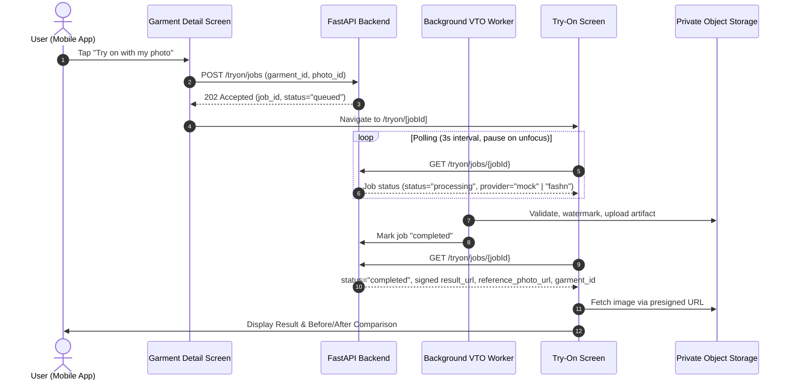

# VTO Phase 7 — Mobile Try-On Experience, Job Progress & Secure Result Delivery

**Project:** FashXStudio  
**Phase:** VTO 7  
**Status:** Implementation specification  
**Prerequisite:** VTO Phase 6 — Result Validation & Artifact Management  

---

## 1. Objective

Connect the virtual try-on backend job lifecycle to the FashXStudio mobile application (Expo / React Native) so users can:
1. Select an authorized garment and initiate a try-on job with duplicate-click protection.
2. Track asynchronous job progress with an adaptive polling strategy that halts upon terminal completion or cancellation.
3. Deliver verified try-on result artifacts securely using authenticated presigned URLs with expiration recovery.
4. Distinguish mock inference from real AI provider results transparently in the user interface.
5. Provide retry capabilities on failed jobs and seamless wardrobe saving using verified garment identifiers.
6. Enable a side-by-side or toggleable before/after comparison between the user's consented reference photo and the generated try-on result.

The mobile client operates strictly as an orchestration client and display layer; it never executes AI inference or accesses raw storage keys directly.

---

## 2. Scope

1. **Backend Status Contract Enhancement:**
   - Extend `GetJobStatusResult` and `TryOnJobStatusResponse` with `garment_id: UUID` and optional `reference_photo_url: str | None`.
   - Resolve reference photo storage key within `GetTryOnJobStatusUseCase` subject to active user consent (`body_photo`).
   - Generate secure presigned GET URLs in `get_tryon_job_status` for both the generated artifact and the reference photo.
2. **OpenAPI & Client Type Sync:**
   - Regenerate `openapi.json` from FastAPI backend.
   - Synchronize TypeScript API definitions in `mobile/src/api/schema.d.ts` using `openapi-typescript`.
3. **Authenticated Artifact Retrieval:**
   - Fix `getTryOnArtifact()` in `mobile/src/features/tryon/tryonApi.ts` to utilize the authenticated `api<TryOnArtifactResponse>()` client rather than unauthenticated `fetch()`.
4. **Adaptive Polling & Focus Awareness:**
   - Implement `isTerminalTryOnStatus` and `getTryOnPollInterval` in `mobile/src/features/tryon/polling.ts`.
   - Update `useJob` React Query hook in `mobile/src/features/tryon/useTryOn.ts` to eliminate `onSuccess` side-effects in `queryFn` and dynamically throttle polling (3 seconds normal, 15 seconds after 10 minutes elapsed).
   - Track screen focus via `useFocusEffect` in `mobile/app/tryon/[jobId].tsx` to pause background network polling when the user leaves the screen.
5. **Garment Detail Submission Guard:**
   - Harden `handleTryOn` in `mobile/app/garment/[id].tsx` with submission state locks, payload validation, and typed error handling.
6. **Try-On Experience Screen:**
   - Provider badge transparency: distinguish `mock`, real AI providers, and `unknown` states clearly.
   - Image expiration recovery: detect signed URL expiration/render errors and provide a refresh action.
   - Wardrobe saving: persist looks using verified `job.garment_id`.
   - Failure retry: initiate a new try-on job for the same garment with stateful progress feedback.
   - Before/After toggle: compare user reference photo with the synthesized try-on render.

---

## 3. Architecture & Integration Flow

---

## 4. Polling Strategy & Lifecycle Specification

To minimize mobile battery drain and API gateway pressure while delivering real-time responsiveness:
- **Interval Timing:**
  - Standard polling: **3,000 ms** (3 seconds).
  - Backoff polling: **15,000 ms** (15 seconds) after a job has been pending for $\ge 600,000$ ms (10 minutes).
- **Terminal Status Halting:**
  - When `job.status` matches `completed`, `failed`, or `cancelled`, `isTerminalTryOnStatus` returns `true`, and `refetchInterval` evaluates to `false`.
- **Focus Gating:**
  - Utilizing `useFocusEffect`, polling is automatically paused when the user switches tabs or backgrounds the screen, resuming immediately when the screen regains focus.

---

## 5. Provider Transparency & Labelling

In strict accordance with repository safety gates and Rule 2:
- **Mock Inference Badge:** Rendered as `Mock preview (synthetic)` when `provider === "mock"`.
- **Real AI Inference Badge:** Rendered as `AI Try-On Result` when `provider` is a real provider (e.g. `fashn`).
- **Unverified Provider:** Rendered as `Synthesized preview` when `provider` is null or unrecognized.

---

## 6. Secure Artifact Delivery & Expiration Handling

- **Authenticated Backend Generation:** Presigned GET URLs are generated on-demand by the backend with short-lived expiration windows (typically 15 minutes).
- **Client Expiration Detection:** If a presigned URL expires while the user is viewing the screen, `Image.onError` sets `imageLoadFailed = true`.
- **User-Initiated Refresh:** A prominent "Reload preview" button refetches the job status via React Query, requesting a freshly signed URL without re-running inference.

---

## 7. Verification & Automated Tests

Automated testing enforces all Phase 7 behaviors across mobile and backend layers:
- `mobile/__tests__/tryon_polling.test.ts`:
  - Validates terminal status identification (`completed`, `failed`, `cancelled`).
  - Verifies polling intervals under normal and backoff durations.
- `mobile/__tests__/tryon_screen.test.tsx`:
  - Tests provider label resolution (`mock`, real, unknown).
  - Verifies wardrobe save payload construction with `job.garment_id`.
  - Verifies retry try-on mutation payload and state transitions.
  - Tests signed URL expiration detection and refresh state machine.
  - Tests before/after view resolution and toggle states.
- `tests/unit/test_vto_job_orchestration.py` & `test_tryon_use_cases.py`:
  - Verifies backend status serialization including `garment_id` and presigned `reference_photo_url`.
