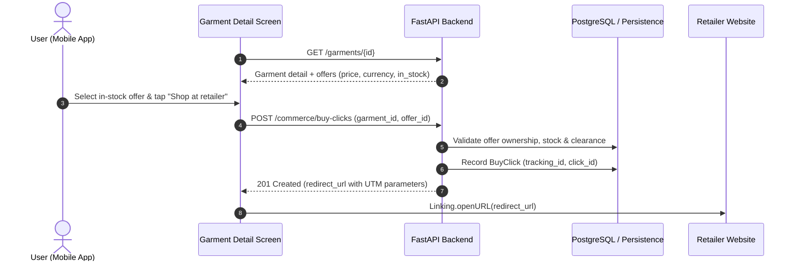

# VTO Phase 8 — Wardrobe, Product Offers & Shopping Handoff

**Project:** FashXStudio  
**Phase:** VTO 8  
**Status:** Implementation specification  
**Scope:** Completed try-on → saved wardrobe → merchant offers → retailer handoff  
**Prerequisite:** VTO Phase 7 — Mobile Try-On Experience & Polling Lifecycle  

---

## 1. Objective

Complete the post-try-on shopping and wardrobe workflow in FashXStudio. A user must be able to:
1. Save a completed virtual try-on look to their personal virtual closet using the true canonical garment identifier and artifact database UUID.
2. Revisit saved items in their wardrobe with immutable snapshot prices, titles, signed thumbnail URLs, and try-on association badges.
3. Compare available merchant offers on the garment detail screen with price, currency, and stock status.
4. Continue seamlessly to the retailer product page via an authenticated, backend-validated, affiliate-attributed redirect URL.

This phase enforces a strict boundary between FashXStudio's generated virtual try-on artifact and the retailer's original commercial listing: saving a generated preview snapshot does not guarantee stock availability or purchase clearance at the retailer.

---

## 2. Existing Components Reused

### Backend
- `backend/fashx/commerce_wardrobe/router.py`: Wardrobe and outbound commerce routes.
- `backend/fashx/commerce_wardrobe/application/save_to_wardrobe.py`: Wardrobe snapshotting use case.
- `backend/fashx/commerce_wardrobe/application/list_wardrobe.py`: Authenticated user wardrobe retrieval with signed URLs.
- `backend/fashx/commerce_wardrobe/application/remove_from_wardrobe.py`: Wardrobe item removal with owner authorization.
- `backend/fashx/commerce_wardrobe/application/create_buy_click.py`: Buy click orchestration, retailer URL validation, and tracking.
- `backend/fashx/commerce_wardrobe/repositories/commerce_wardrobe_repository.py`: Persistence unit of work for wardrobe items and buy clicks.
- `backend/fashx/catalog/customer_router.py`: Customer-facing garment detail endpoints.
- `backend/fashx/tryon/application/get_job_status.py`: Try-on job status resolution use case.
- `backend/fashx/tryon/router.py`: Try-on job status API.

### Database
- `database/models/commerce_feedback.py`: `WardrobeItem` and `BuyClick` entities.
- `database/models/catalog.py`: `CanonicalGarment`, `Merchant`, `MerchantProduct`, `MerchantOffer`.
- `database/models/tryon.py`: `TryOnJob` and `TryOnArtifact`.

### Mobile
- `mobile/src/features/wardrobe/api.ts`: Wardrobe REST client.
- `mobile/src/features/wardrobe/hooks.ts`: Wardrobe React Query hooks.
- `mobile/app/(tabs)/closet.tsx`: Wardrobe collection screen.
- `mobile/app/garment/[id].tsx`: Garment detail and merchant offer presentation.
- `mobile/app/tryon/[jobId].tsx`: Try-on result viewing and save look action.

---

## 3. Required Implementation & Architecture

### 3.1 Try-On Identity Contract
- `GetJobStatusResult` and `TryOnJobStatusResponse` expose `garment_id: UUID` and `artifact_id: UUID | None`.
- The mobile save handler (`handleSaveLook`) sends the verified `job.garment_id` and database UUID `job.artifact_id`.
- Mobile screens never parse or derive a garment ID or artifact ID from composite storage keys (`artifact_key`).

### 3.2 Artifact Ownership & Garment Validation
Before persisting an artifact reference to `WardrobeItem`:
- Verify the artifact exists in `TryOnArtifactRepository`.
- Verify the originating `TryOnJob` belongs to the authenticated user (`job.user_id == principal.user_id`).
- Verify the job was run against the requested garment (`job.garment_id == request.garment_id`).
- Verify the job status is `completed`.
- Reject invalid, unowned, or mismatched references with HTTP 403 / 404.

### 3.3 Wardrobe Management
- **POST `/wardrobe/items`**: Idempotent duplicate save protection. Repeated saves of the same garment update snapshot context without creating duplicate rows.
- **GET `/wardrobe/items`**: Strictly isolated to authenticated user identity; generates short-lived signed URLs for snapshot images.
- **DELETE `/wardrobe/items/{item_id}`**: Ownership-enforced item deletion with concurrency protection.

### 3.4 Retailer Offers & Outbound Handoff
- **Customer Garment Detail**: Exposes available merchant offers (`CustomerOfferDetail`) with price, currency, and stock status.
- **Create Buy Click**:
  - Verifies offer existence and that the offer belongs to the specified garment.
  - Rejects out-of-stock offers (`offer.in_stock == False`) with HTTP 422 `ValidationError`.
  - Enforces catalog source clearance (`source.status == "cleared"`).
  - Validates HTTPS scheme, absence of embedded credentials, and allowed retailer hosts (`FASHX_RETAILER_ALLOWED_HOSTS`).
  - Records a `BuyClick` tracking event and returns an attributed redirect URL containing `utm_source`, `utm_medium`, `utm_campaign`, `sub_id`, and `click_id`.

---

## 4. Product Variant Boundary

- **Phase 8 Decision**: The current schema models offers at the `MerchantOffer` level (merchant, source product, price, currency, stock status).
- **MVP Presentation**: Users compare and select among available retailer offers. Available size labels (`CanonicalGarment.sizes_in_stock`) are displayed as garment-level availability without assuming offer-specific variant mapping.
- **Future Variant Model Extension**: A future phase will introduce `MerchantProductVariant` mapped to size/color SKU feeds when partner data sources provide variant-level URLs.

---

## 5. Acceptance Criteria

- Completed virtual try-ons save to the user's wardrobe using verified `garment_id` and `artifact_id`.
- Artifact ownership is validated: saving an artifact belonging to another user or garment is denied (HTTP 403).
- Wardrobe items are strictly isolated to the authenticated user.
- Out-of-stock offers are disabled in the UI and rejected server-side (HTTP 422).
- Mismatched offer-garment pairs are rejected server-side (HTTP 422).
- Outbound redirect URLs require HTTPS, contain no credentials, and match permitted retailer hosts.
- The mobile app opens only backend-validated redirect URLs via `Linking.openURL`.
- All backend and mobile unit tests pass with zero regressions.
