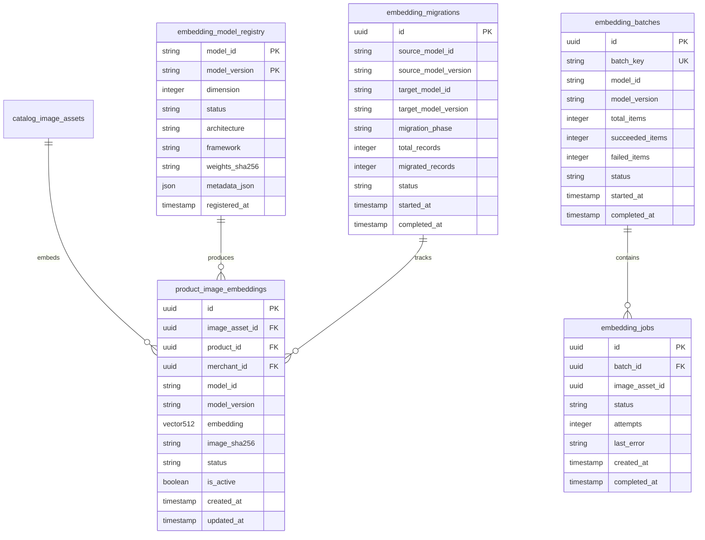

# Fashion Image Embedding Database Schema

## 1. Schema Design
The embedding subsystem introduces dedicated relational tables in PostgreSQL, utilizing `pgvector` for vector storage and indexing.

---

## 2. Table Specifications

### 2.1 `product_image_embeddings`
Stores the generated visual vectors and links them to catalog assets and products:
- `id`: UUID primary key.
- `image_asset_id`: Foreign key referencing `catalog_image_assets.id` (ON DELETE CASCADE).
- `product_id`: UUID of canonical or source product.
- `merchant_id`: UUID of merchant owning the image.
- `model_id`: Model identifier (e.g. `openclip_vit_b32`).
- `model_version`: Checkpoint version (e.g. `v1`).
- `embedding`: 512-dimensional vector (`Vector512` in SQLAlchemy, using `vector(512)` on PostgreSQL and string serialization on SQLite).
- `image_sha256`: SHA-256 hash of normalized image bytes used during embedding.
- `status`: Lifecycle state (`ACTIVE`, `SUPERSEDED`, `QUARANTINED`, `FAILED`).
- `is_active`: Boolean flag indicating if this is the active vector for product search.
- **Constraints**:
  - Unique constraint on `(image_asset_id, model_id, model_version)` to enforce idempotent single embeddings per image/model version.
  - Partial index on `is_active = TRUE` for performant search.

### 2.2 `embedding_model_registry`
Tracks approved models and their runtime metadata:
- `model_id`: Primary key component.
- `model_version`: Primary key component.
- `dimension`: Vector dimensionality (512).
- `status`: `APPROVED`, `EVALUATION`, `DEPRECATED`, `RETIRED`.
- `architecture`: String description (e.g., `ViT-B/32`).
- `framework`: `openclip`, `pytorch`, etc.
- `weights_sha256`: Verification hash of weights.
- `registered_at`: Timestamp.

### 2.3 `embedding_batches` and `embedding_jobs`
Durable tracking for asynchronous bulk embedding jobs:
- Enables resume-from-failure and progress monitoring.
- Prevents redundant image recomputation.

### 2.4 `embedding_migrations`
Controls blue/green zero-downtime model cutovers.
