# Model Version Migration Specification

## 1. Zero-Downtime Blue/Green Vector Migration
When upgrading the embedding model (e.g. from `openclip_vit_b32:v1` to `v2` or a domain-fine-tuned model):
- Vectors from different models cannot be directly compared via cosine distance.
- Dual-model coexistence is mandatory during the migration window.

---

## 2. Five-Phase Migration Lifecycle

```mermaid
stateDiagram-v2
    [*] --> PREPARATION: Register target model in embedding_model_registry
    PREPARATION --> DUAL_WRITE: New ingestion generates vectors for BOTH models
    DUAL_WRITE --> BACKFILL: Background worker backfills target model vectors
    BACKFILL --> CANARY: Route 10% search traffic to target model index
    CANARY --> CUTOVER: Route 100% search traffic; set target is_active=TRUE
    CANARY --> ROLLBACK: Rollback canary if retrieval quality degrades
    CUTOVER --> DEPRECATION: Deprecate source model; mark retired after grace period
    DEPRECATION --> [*]
```



### Phase 1: Preparation
- Register the new model in `embedding_model_registry` with `status='EVALUATION'`.
- Validate weights checksum and run evaluation suite against standard fashion test dataset.

### Phase 2: Dual Write
- Catalog ingestion pipelines write embeddings for both the active (`BLUE`) and candidate (`GREEN`) models.
- Only the `BLUE` model has `is_active=TRUE`.

### Phase 3: Historical Backfill
- Asynchronous batch jobs iterate over historical catalog image assets and generate missing `GREEN` vectors.
- Progress tracked via `embedding_migrations`.

### Phase 4: Canary Evaluation
- 5% to 10% of similarity retrieval queries evaluate `GREEN` embeddings in shadow or split mode.
- Check retrieval recall and click-through rates.

### Phase 5: Atomic Cutover & Rollback
- Atomic database update:
  ```sql
  UPDATE product_image_embeddings SET is_active = FALSE WHERE model_id = :blue_id AND model_version = :blue_ver;
  UPDATE product_image_embeddings SET is_active = TRUE WHERE model_id = :green_id AND model_version = :green_ver;
  ```
- Instant rollback: Simply revert `is_active` flags back to `BLUE` if anomalous retrieval behavior is detected.
