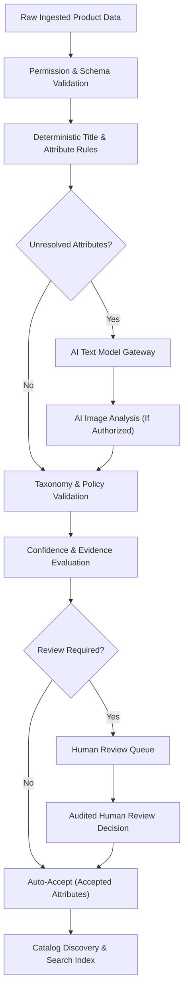

# Phase 06.2 — Product Enrichment Architecture

## 1. System Overview

Product Enrichment converts raw, inconsistent merchant product feeds into structured, evidence-backed fashion attributes using deterministic rules, AI text understanding, and authorized image analysis.

## 2. Core Architectural Principles

1. **Separation of Ingestion, Enrichment, and Search**:
   Enrichment operates as a distinct asynchronous stage between catalog ingestion (Phase 05.3/05.5) and search indexing (Phase 06.5). It takes a read-only snapshot of source data and generates versioned, immutable enrichment runs.

2. **Strict Evidence Requirement**:
   AI models and extraction rules may interpret available evidence, but must **never manufacture facts**.
   - **Fabric Rule**: 100% cotton or specific fiber blend percentages must never be inferred unless explicitly stated in merchant data.
   - **Size Rule**: Available sizes, size charts, and body measurements are **source-only**. An AI model attempting to invent sizes is rejected at the schema boundary.

3. **Hybrid Extraction Order (Cost & Latency Optimization)**:
   - **P0**: Structured merchant fields and deterministic regex rules.
   - **P1**: Taxonomy mapping and alias lookup.
   - **P2**: Bounded AI text extraction for ambiguous descriptors or occasions.
   - **P3**: Authorized multimodal image analysis for visual colors/patterns.

4. **Multi-Tenant Human Review**:
   Platform reviewers can inspect and resolve attributes across all merchants, while merchant operators can review only their own products.
