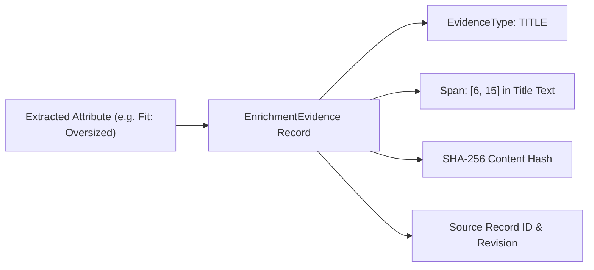

# Phase 06.2 — Evidence and Provenance Policy

## 1. Traceable Evidence Model

Every extracted attribute must link to an immutable evidence record identifying its origin.

## 2. Evidence Types

- `MERCHANT_FIELD`: Direct structured field from source catalog.
- `TITLE`: Text span matched within the product title with exact offsets.
- `DESCRIPTION`: Text span matched within product description.
- `IMAGE_ASSET`: Visual feature derived from an authorized internal image asset.
- `SOURCE_SPECIFICATION`: Technical spec sheet or manufacturer feed.
- `RULE_MATCH`: Deterministic regex rule match.
- `AI_TEXT_EXTRACTION`: Attribute inferred by language model with model metadata.
- `AI_IMAGE_EXTRACTION`: Attribute inferred by vision model with asset reference.
- `HUMAN_CORRECTION`: Attribute manually supplied by an authorized human reviewer.

## 3. Offset and Content Validation

- For text evidence, `start_offset` and `end_offset` must match the substring in `evidence_text`.
- SHA-256 content hashes ensure evidence integrity cannot be tampered with in storage.
