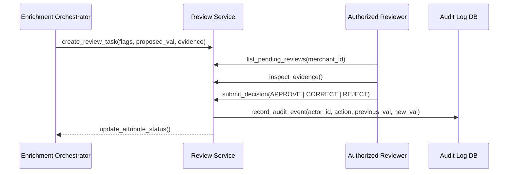

# Phase 06.2 — Human Review Workflow Specification

## 1. Review Workflow

## 2. Reviewer Capabilities

1. **Approve**: Confirms proposed attribute value with recorded audit reason.
2. **Correct**: Updates attribute value to a valid Phase 06.1 taxonomy term. Preserves previous value in audit history.
3. **Reject**: Discards proposed value, preventing it from publishing to search indexing.
4. **Mark Unknown**: Marks attribute as `UNKNOWN` when source evidence is genuinely absent.

## 3. Tenant Isolation and Role Security

- `PLATFORM_ADMIN` & `PLATFORM_REVIEWER`: Can inspect and decide reviews across all merchants.
- `MERCHANT_REVIEWER`: Strictly restricted to reviewing products belonging to their authenticated `merchant_id`. Cross-merchant review attempts raise `ReviewPermissionError` (403 Forbidden).
