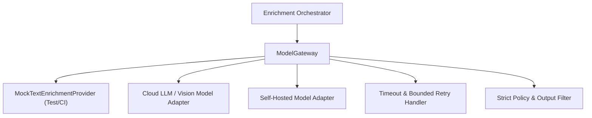

# Phase 06.2 — AI Model Integration and Provider Gateway

## 1. Gateway Design

The `ModelGateway` abstracts external and self-hosted AI models behind a consistent interface (`TextEnrichmentProvider` and `VisionEnrichmentProvider`).

## 2. Anti-Hallucination Prompt Architecture

- All merchant fields are treated as untrusted data inputs, not instructions.
- System prompt strictly bans generating available sizes, size charts, fiber percentages, price, or inventory.
- Output is enforced via strict JSON schema validation.

## 3. Resilience and Latency Bounding

- Bounded retries: Maximum 2 retries with exponential backoff on transient network timeouts.
- Non-retryable errors (e.g. policy violations, schema rejections) fail immediately.
- Comprehensive latency, token usage, and cost tracking recorded in `product_enrichment_model_runs`.
