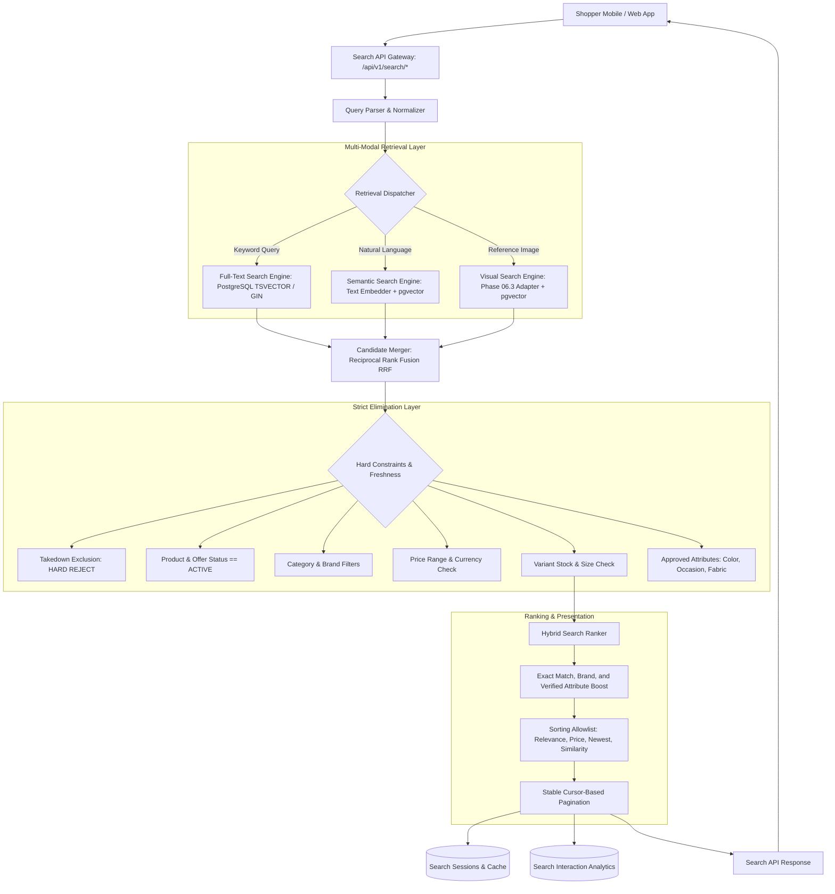

# Fashion Product Search Architecture

## 1. System Overview
Phase 06.4 establishes FashXStudio's unified fashion product search engine. It synthesizes previous fashion intelligence subsystems:
- **Phase 06.1 Taxonomy**: Hierarchical categories, garment types, normalized colors, patterns, occasions, and audiences.
- **Phase 06.2 Product Enrichment**: Structured attributes, confidence scoring, evidence references, and human review verification.
- **Phase 06.3 Image Embeddings**: OpenCLIP 512-dim visual vectors and pgvector nearest-neighbor search.
- **Phase 05 Catalog & Freshness**: Merchant product records, offers, variant sizes, inventory states, and dynamic takedowns.

The search engine is not four separate disjoint features, but a single **hybrid multi-modal retrieval system** with a shared filtering, ranking, pagination, and freshness layer.

---

## 2. Target System Architecture

---

## 3. Core Architectural Decisions

| Decision Area | Selected Technology | Rationale & Trade-offs |
| :--- | :--- | :--- |
| **Search API** | FastAPI (Python 3.12) | Asynchronous, strict Pydantic V2 validation, native integration with existing services. |
| **Primary Database** | PostgreSQL 16 + `pgvector` | Unified relational and vector storage; avoids split-brain synchronization issues. |
| **Keyword Search** | PostgreSQL Full-Text Search (`tsvector`, `tsquery`, GIN) | Weighted document matching (Title 'A', Brand 'A', Description 'D') with zero third-party infra overhead. |
| **Fuzzy Matching** | PostgreSQL `pg_trgm` / trigram similarity | Typo tolerance and brand alias resolution without separate search cluster. |
| **Semantic Search** | OpenCLIP Joint Text-Image Embedding Space (512-dim) | Shared multimodal representation allows direct cross-modal alignment. |
| **Visual Search** | Phase 06.3 Image Embedding Pipeline | Reuses approved OpenCLIP ViT-B/32 adapters with unit L2 normalization. |
| **Hybrid Merger** | Reciprocal Rank Fusion (RRF) | Merges disparate score distributions without requiring artificial calibration: $RRF(d) = \sum \frac{1}{k + rank(d)}$. |
| **Pagination** | Opaque Token-Based Cursor Pagination | Stable snapshot/session ordering; eliminates offset drift and deep-page scan overhead. |
| **Infrastructure Boundary** | Self-Hosted PostgreSQL / No external search SaaS | Meets Rule I06 and privacy invariants; benchmarked against expected MVP catalog scale. |

---

## 4. Hard Constraints vs. Soft Signals
A critical principle of the FashXStudio search engine is that **semantic similarity and visual similarity are not substitutes for exact filtering**:
- If a shopper specifies **Size: M**, **Max Price: ₹1,500**, and **Category: Kurtas**, these are applied as **strict database constraints** (eliminating non-matching products), not soft preferences.
- Soft signals (cosine similarity, TF-IDF relevance, text matching) are used **strictly for ranking** among the subset of products that satisfy all hard constraints.
- **Takedowns and Delisted Products**: Takedowns represent a zero-tolerance exclusion. A cached ranking or recommendation must never surface a taken-down or inactive asset.
