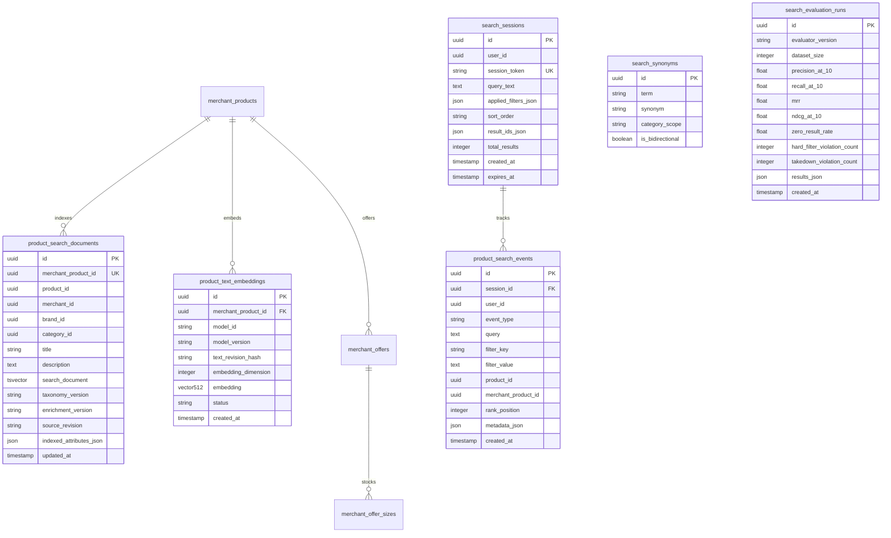

# Fashion Product Search Data Model

## 1. Searchable Unit & Entities
In FashXStudio, the atomic unit of shopper search is the **Merchant Product Listing** (`MerchantProduct` / `ProductSearchDocumentRecord`), paired with its **Active Eligible Offer** (`MerchantOffer`).

This design guarantees that:
1. Prices and currencies belong strictly to the merchant who sells the item.
2. Sizing availability evaluates the exact variant SKU inventory belonging to that merchant.
3. Brands and merchants are never conflated (e.g., Roadster is a brand, Myntra is a merchant).

---

## 2. Relational Search Schema

---

## 3. Search Document Definition
The normalized `search_document` field is constructed from verified and approved catalog attributes:
$$\text{Document} = \text{Title (Weight A)} \parallel \text{Brand (Weight A)} \parallel \text{Garment Type (Weight B)} \parallel \text{Color \& Occasion (Weight B)} \parallel \text{Description (Weight D)}$$

Only approved attributes from Phase 06.2 (`review_status in ('AUTO_ACCEPTED', 'APPROVED')`) with high confidence are incorporated into the search document. Unverified AI fabric inferences or speculative measurements are strictly excluded.
