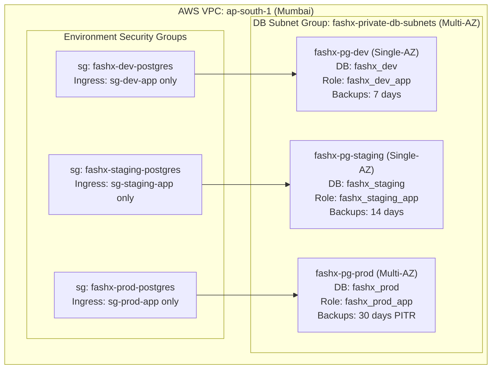

# AWS RDS for PostgreSQL Architecture Specification

## 1. Executive Summary & Topology

FashXStudio deploys **Amazon RDS for PostgreSQL 16** in region **`ap-south-1` (Mumbai, India)** utilizing three independent managed database instances to ensure total isolation between runtime environments:

---

## 2. Environment Specifications

| Dimension | Development | Staging (RC) | Production |
| :--- | :--- | :--- | :--- |
| **Instance Identifier** | `fashx-pg-dev` | `fashx-pg-staging` | `fashx-pg-prod` |
| **Instance Class** | `db.t4g.micro` (2 vCPU, 1 GB) | `db.t4g.small` (2 vCPU, 2 GB) | `db.t4g.medium` (2 vCPU, 4 GB) / `db.r6g.large` |
| **High Availability** | Single-AZ | Single-AZ | Multi-AZ (Synchronous standby, <60s failover) |
| **Database Name** | `fashx_dev` | `fashx_staging` | `fashx_prod` |
| **Runtime Application Role** | `fashx_dev_app` | `fashx_staging_app` | `fashx_prod_app` |
| **Migration DDL Role** | `fashx_dev_migrator` | `fashx_staging_migrator`| `fashx_prod_migrator` |
| **Storage (gp3)** | 20 GB (Autoscale to 100 GB) | 20 GB (Autoscale to 100 GB) | 100 GB (Autoscale to 1,000 GB) |
| **Storage Encryption** | AWS Managed RDS KMS Key | AWS Managed RDS KMS Key | Customer Managed KMS Key (`fashx-rds-key`) |
| **Automated Backup Retention**| 7 days | 14 days | 30 days continuous WAL (PITR) |
| **Backup Maintenance Window** | 18:00–18:30 UTC | 18:00–18:30 UTC | 18:00–18:30 UTC (23:30–00:00 IST) |
| **Deletion Protection** | Enabled (`prevent_destroy`) | Enabled (`prevent_destroy`)| Enabled (`prevent_destroy`) |
| **Publicly Accessible** | `false` | `false` | `false` |
| **TLS / SSL Requirement** | `rds.force_ssl=1` | `rds.force_ssl=1` | `rds.force_ssl=1` (Strict verify-full) |
| **Secrets Manager Path** | `/fashx/dev/postgres/*` | `/fashx/staging/postgres/*` | `/fashx/prod/postgres/*` |

---

## 3. Infrastructure as Code (Terraform)

The database tier is codified in `infra/aws/rds/`:
- `versions.tf`: Pins Terraform `>= 1.10.0` and AWS provider `>= 5.80, < 7.0` with S3 remote state backend and state locking.
- `variables.tf`: Parameterizes VPC ID, private subnet IDs (minimum 2 AZs), application security groups, engine version (`16.3`), and instance classes.
- `main.tf`: Provisions `aws_db_subnet_group.fashx`, `aws_db_parameter_group.postgres16` (`rds.force_ssl=1`), 3 environment-specific security groups, and 3 `aws_db_instance` resources with AWS Secrets Manager master user password integration (`manage_master_user_password = true`).
- `outputs.tf`: Exports private endpoints, security group IDs, and master secret ARNs.
- `terraform.tfvars.example`: Reference configuration template for deployment engineers.

---

## 4. Role & Secret Management Architecture

Application and migration credentials are decoupled from the administrative master secret:
1. **Master Credential**: Generated and rotated automatically by AWS RDS in Secrets Manager. Reserved strictly for bootstrapping and emergency administrative intervention.
2. **Application Role (`fashx_<env>_app`)**:
   - Stored in AWS Secrets Manager: `fashx/<env>/postgres/app`.
   - Granted strictly DML rights (`SELECT`, `INSERT`, `UPDATE`, `DELETE`) on tables in schema `public`.
   - Explicitly denied `CREATE`, `DROP`, `ALTER`, and `TRUNCATE`.
3. **Migration Role (`fashx_<env>_migrator`)**:
   - Stored in AWS Secrets Manager: `fashx/<env>/postgres/migrator`.
   - Schema owner with DDL execution rights used exclusively by ECS migration tasks during deployment.
4. **Bootstrap Automation**: Implemented in [`scripts/db/bootstrap_rds_roles.sh`](file:///c:/Users/ASUS/Documents/FashXStudio/scripts/db/bootstrap_rds_roles.sh).

---

## 5. Security & Isolation Invariants

1. **Zero Public Ingress**: Database instances reside in private subnets with no route to an Internet Gateway. Ingress is permitted strictly on port 5432 from the matching environment's application security group.
2. **Cross-Environment Denial**: Security groups and credentials strictly prevent Development or Staging tasks from querying `fashx-pg-prod`.
3. **Mandatory TLS**: The custom parameter group sets `rds.force_ssl=1`. Client drivers connect with `sslmode=verify-full` using the AWS RDS global certificate authority bundle.
