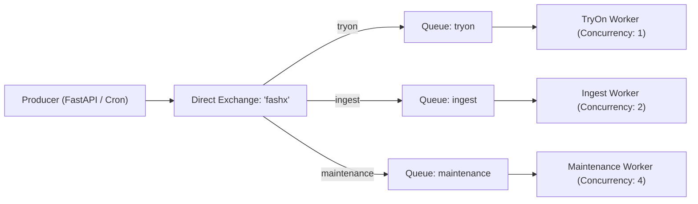

# FashXStudio — Celery Queue Design & Routing Topology (Phase 03.3)

## 1. Queue Topology
Tasks are partitioned across three dedicated queues to isolate long-running compute workloads from operational and transactional background jobs.



---

## 2. Queue Configuration & Mapping
Configured in `backend/fashx/workers/queue_config.py`:

| Queue Name | Routing Key | Durable | Workload Purpose | Dedicated Worker Service |
| :--- | :--- | :--- | :--- | :--- |
| **`tryon`** | `tryon` | Yes | Virtual try-on pipeline execution and external provider inference polling. | `fashx-worker-tryon` |
| **`ingest`** | `ingest` | Yes | Merchant catalog feed validation, ingestion, and VLM attribute enrichment. | `fashx-worker-ingest` |
| **`maintenance`** | `maintenance` | Yes | Outbox message relay, S3 media erasure sweeping, nightly data retention cleanups. | `fashx-worker-maintenance` |

---

## 3. Task Route Registry
All Celery tasks are explicitly declared in `TASK_ROUTES`:

```python
TASK_ROUTES = {
    "fashx.workers.app.process_tryon_job": {
        "queue": "tryon",
        "routing_key": "tryon",
    },
    "fashx.workers.app.ingest_catalog_feed": {
        "queue": "ingest",
        "routing_key": "ingest",
    },
    "fashx.workers.app.enrich_garment_task": {
        "queue": "ingest",
        "routing_key": "ingest",
    },
    "fashx.workers.app.relay_outbox_events": {
        "queue": "maintenance",
        "routing_key": "maintenance",
    },
    "fashx.workers.app.sweep_storage_erasure": {
        "queue": "maintenance",
        "routing_key": "maintenance",
    },
    "fashx.workers.app.run_retention_jobs": {
        "queue": "maintenance",
        "routing_key": "maintenance",
    },
}
```

---

## 4. Worker Concurrency and Prefetch Policy
1. **Worker Prefetch Multiplier**: `worker_prefetch_multiplier = 1`. 
   - Prevents worker starvation. When a worker is busy processing a long-running VTO job (up to 105s), Celery will not greedily buffer additional tasks into that worker container.
2. **Dedicated Concurrency Profiles**:
   - `tryon` worker containers run with `--concurrency=1` to dedicate CPU and memory resources to inference orchestration.
   - `ingest` worker containers run with `--concurrency=2`.
   - `maintenance` worker containers run with `--concurrency=4` for high-throughput asynchronous I/O.
3. **Late Acknowledgment**:
   - `task_acks_late = True`: Tasks are acknowledged only upon successful completion.
   - `task_reject_on_worker_lost = True`: If a worker container crashes or is abruptly killed by ECS, unacknowledged tasks are re-queued immediately by Redis.
