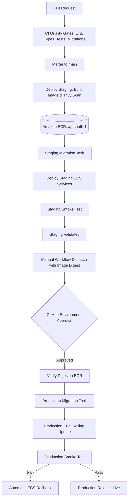

# CI/CD Architecture Specification

## 1. Pipeline Overview

FashXStudio implements an automated, immutable container release pipeline using GitHub Actions, Amazon Elastic Container Registry (ECR), and Amazon Elastic Container Service (ECS) Fargate in the AWS Mumbai region (`ap-south-1`).

The pipeline enforces separation between validation (continuous integration), artifact generation (immutable container build & vulnerability scan), staging deployment, and production release promotion.

## 2. Core Architectural Principles

1. **Build Once, Deploy Many (Immutability)**:
   - A single container image is compiled from the source code and pushed to ECR tagged with the Git commit SHA (`sha-<commit>`) and cryptographic digest (`sha256:...`).
   - The exact same image digest tested on staging is promoted to production. Production never rebuilds from source.

2. **Least Privilege AWS Authentication (OIDC)**:
   - No long-lived AWS IAM access keys or secret keys are stored in GitHub Secrets.
   - GitHub Actions assumes dedicated IAM execution roles via OpenID Connect (OIDC) with trust policies scoped strictly to the repository and branch/environment.

3. **Zero Secrets in Logs**:
   - Environment variables, secrets, and connection URIs are injected into tasks via AWS Secrets Manager and Systems Manager (SSM) Parameter Store at ECS runtime.
   - Post-deployment smoke tests and CI jobs sanitize user identifiers, auth tokens, and sensitive headers from all console outputs.

4. **Automated Migration Sequencing**:
   - Database migrations (`alembic upgrade head`) execute in an isolated, one-off ECS Fargate task *before* rolling application container updates begin.
   - If the database migration task exits with a non-zero exit code, deployment immediately terminates before any application traffic is routed to the new revision.

5. **Circuit-Breaker Deployments and Automated Rollback**:
   - ECS services utilize native deployment circuit breakers (`deploymentCircuitBreaker={enable=true,rollback=true}`).
   - If post-deployment smoke tests fail, deployment scripts trigger automated rollback to the previously captured task definition revisions via `scripts/release/rollback_ecs.sh`.

## 3. Workflow Roster

| Workflow File | Trigger | Environment Target | Key Responsibilities |
| :--- | :--- | :--- | :--- |
| `.github/workflows/ci.yml` | `pull_request`, `push: [main]` | Ephemeral CI Runners | Linting, static typing, unit tests, integration tests (PostgreSQL + Redis service containers), Alembic migration rollback/forward check, mobile bundle check, pip-audit vulnerability scan. |
| `.github/workflows/deploy-staging.yml` | `workflow_run` (after `ci` on `main`), `workflow_dispatch` | `staging` | Container build, ECR push, Trivy CVE scan, staging Alembic migration, rolling ECS service update, smoke test, automated rollback. |
| `.github/workflows/deploy-production.yml` | `workflow_dispatch` (requires input `image_digest`) | `production` (Protected) | Digest regex validation, manual founder approval gate, ECR digest verification, production Alembic migration, rolling ECS update, smoke test, automated rollback. |
| `.github/workflows/deploy.yml` | `workflow_dispatch` (choice `staging` or `prod`) | `staging` / `prod` | Unified deployment dispatch supporting manual parameter selection with task rendering and rollback safety. |
