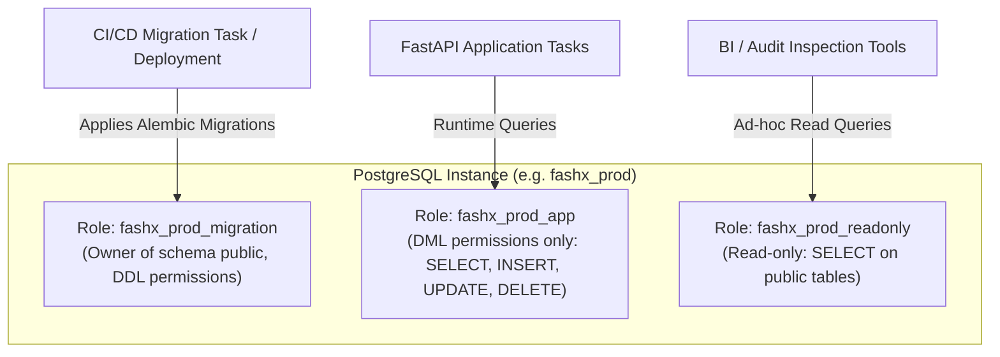

# Database Isolation and Security Architecture

## 1. Segregation Rules

To guarantee zero cross-environment contamination and prevent catastrophic data loss:

1. **Independent Clusters**: Development, Staging, and Production database instances must run on physically or logically separated managed database clusters. Under no circumstances may development or staging tenants share a PostgreSQL instance, storage volume, or cluster with production.
2. **Dedicated VPCs**: Hosted databases reside strictly in private database subnets with no public IP allocation. Ingress is restricted via Security Groups strictly to ECS application tasks within the identical environment VPC.
3. **No Direct Production Peering**: VPC peering between Development or Staging VPCs and the Production VPC is forbidden.

---

## 2. SSL/TLS Connection Invariants

All connections to hosted PostgreSQL databases must enforce encryption in transit:
- **Async Driver Format**: `postgresql+asyncpg://<user>:<password>@<host>:<port>/<dbname>?ssl=require`
- **SSL Mode**: In Staging and Production, `ssl=require` or `ssl=verify-full` is mandatory. Any unencrypted connection attempt will be rejected at the PostgreSQL parameter group level (`rds.force_ssl=1`).

---

## 3. Database Roles & Least Privilege Access

To enforce the principle of least privilege and protect schemas against accidental or malicious runtime mutation, three distinct database roles are provisioned per environment:

### 3.1 Migration Role (`fashx_<env>_migration`)
- **Assigned to**: Dedicated ECS Migration Task executed during deployment.
- **Permissions**: Full DDL permissions (CREATE TABLE, ALTER TABLE, DROP TABLE, CREATE INDEX, etc.) and schema ownership.
- **Scope**: Used exclusively by Alembic migrations (`alembic upgrade head`). The running FastAPI application does **not** have access to these credentials.

### 3.2 Application Runtime Role (`fashx_<env>_app`)
- **Assigned to**: FastAPI ECS service tasks.
- **Permissions**: Granted strictly DML rights: `SELECT`, `INSERT`, `UPDATE`, `DELETE` on all existing and future tables in schema `public`.
- **Restrictions**: Explicitly denied `DROP TABLE`, `ALTER TABLE`, `TRUNCATE`, and superuser attributes. Even if an SQL injection vulnerability were present in application code, schema destruction is blocked at the database engine level.

### 3.3 Read-Only Role (`fashx_<env>_readonly`)
- **Assigned to**: Engineering audit, analytics, and operational diagnostic tools.
- **Permissions**: `SELECT` rights only.

---

## 4. Backup, Point-In-Time-Recovery (PITR), and Retention

| Environment | Automated Backup Cadence | PITR Retention Window | Snapshot Strategy |
| :--- | :--- | :--- | :--- |
| **Development** | Daily snapshots | 1 day | Retain 3 most recent snapshots |
| **Staging** | Daily automated snapshots | 7 days | Pre-deployment manual snapshot before major RC runs |
| **Production** | Continuous WAL archiving + Daily snapshot | 35 days | Pre-deployment manual snapshot + Monthly compliance snapshot |

---

## 5. Acceptance Criteria and Verification Protocol

The following 8 criteria must be satisfied prior to declaring database isolation operational:

1. [ ] **Isolation Check 1**: Staging and Production database endpoints resolve to distinct hostnames in separate VPC subnets.
2. [ ] **Isolation Check 2**: Application tasks running under `fashx_prod_app` cannot execute `DROP TABLE` or `CREATE TABLE` statements.
3. [ ] **Isolation Check 3**: Database parameter groups enforce `rds.force_ssl=1`, rejecting unencrypted connections.
4. [ ] **Isolation Check 4**: Database connection strings in application configuration use `ssl=require`.
5. [ ] **Isolation Check 5**: Migration tasks run as an isolated one-off task definition with `fashx_<env>_migration` credentials.
6. [ ] **Isolation Check 6**: Continuous WAL archiving is active and verified in AWS RDS console / metrics.
7. [ ] **Isolation Check 7**: Database credentials stored in AWS Secrets Manager use automatic rotation every 90 days.
8. [ ] **Isolation Check 8**: Restoring an RDS snapshot into an isolated temporary test database completes successfully in a scheduled rehearsal.
