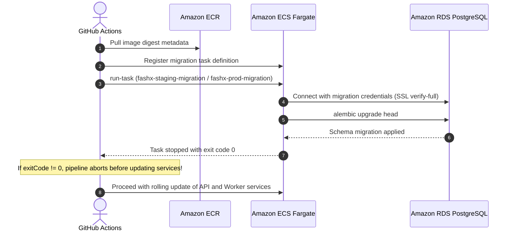

# Database Migration Pipeline Specification

## 1. Governance and Invariants

In accordance with `AGENTS.md` Rule 5:
- Every data model change requires an Alembic migration script in `database/versions/`.
- Every migration must be tested bidirectionally (`upgrade head`, `downgrade -1`, `upgrade head`, `alembic check`).
- Migrations must be backward-compatible with running application versions (the Expand/Contract pattern).

## 2. CI Verification Pipeline

During CI execution (`.github/workflows/ci.yml`), migration verification runs against a live PostgreSQL 16 instance:

```bash
# 1. Verify single head revision (no conflicting branching)
python -m alembic heads

# 2. Upgrade from clean base to latest head
python -m alembic upgrade head

# 3. Test rollback capability (downgrade one revision)
python -m alembic downgrade -1

# 4. Re-apply to head
python -m alembic upgrade head

# 5. Verify models match database schema (zero drift)
python -m alembic check
```

## 3. ECS Deployment Execution

In staging (`deploy-staging.yml`) and production (`deploy-production.yml`), database migrations are never executed inside running API web containers. Instead, they run as an ephemeral, isolated ECS Fargate task:



## 4. Disaster and Rollback Controls

1. If a migration task fails, the pipeline immediately halts. No application services are updated.
2. Destructive schema changes (dropping columns or tables) must occur in a subsequent release after all old code referencing the column is retired (Contract phase).
