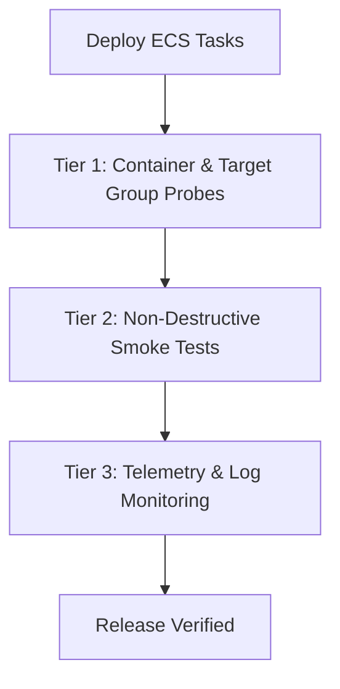

# Deployment Verification Specification

## 1. Multi-Tier Verification Strategy

Deployment verification ensures that a deployed release candidate is functional, performant, and secure before receiving live merchant or customer traffic.

## 2. Tier 1: Infrastructure & Container Probes

1. **ECS Container Healthcheck**:
   - Executes inside container: `python -c "import urllib.request; urllib.request.urlopen('http://127.0.0.1:8000/healthz/live')"`
   - Interval: 20s, Timeout: 5s, Retries: 3.
2. **ALB Target Group Health Probe**:
   - Endpoint: `/healthz/live`
   - Success code: HTTP 200.
3. **Readiness Probe**:
   - Endpoint: `/healthz/ready` (or `/api/v1/system/health/ready`)
   - Verifies database connectivity, Redis ping, and schema version compatibility.

## 3. Tier 2: Post-Deployment Smoke Test (`smoke.py`)

The automated smoke test runs non-destructive checks:
- **Public Probes**: Validates `/healthz/live`, `/healthz/ready`, and `/api/v1/config`.
- **Identity Check**: Queries `/api/v1/me` with synthetic token; scrubs identifiers from logs.
- **Feed Freshness**: Queries `/api/v1/feed?limit=20` and asserts price freshness timestamp (`price_as_of` or `price`).
- **Reporting**: Emits summary count of passed/failed checks with non-zero exit code on any failure.

## 4. Tier 3: Telemetry & Error Tracking

During the first 30 minutes following release:
- CloudWatch metrics for ALB 5xx and ECS task CPU/Memory utilization.
- Sentry error monitoring for new unhandled exceptions.
- Celery worker queue depth and dead-letter queue count monitoring.
