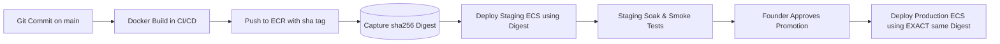

# Amazon ECR Image Versioning and Promotion Policy

## 1. Registry Topology

FashXStudio maintains private Amazon Elastic Container Registry (ECR) repositories in AWS Mumbai (`ap-south-1`):

- **Repository**: `${ACCOUNT_ID}.dkr.ecr.ap-south-1.amazonaws.com/fashx`
- **Encryption**: AWS KMS (`aws/ecr` or custom KMS CMK).
- **Tag Immutability**: Enabled in ECR to prevent overwriting existing tags.
- **Image Scanning**: Scan on Push enabled (`SCAN_ON_PUSH=true`).

## 2. Tagging Convention

Every build produces two canonical references:

1. **Commit SHA Tag**:
   - Format: `sha-<full_git_commit_sha>` (e.g. `sha-6862f8c5b9f91a0c841c5905fcfd35702bb2b450`).
   - Links the container image directly to the exact Git commit in source control.
2. **Cryptographic Digest (Canonical Promotion Identifier)**:
   - Format: `sha256:<64_hex_digits>` (e.g. `sha256:d8a2...3f1c`).
   - The digest is immutable and guarantees byte-for-byte identity between staging validation and production promotion.

## 3. Promotion Flow

## 4. Lifecycle Rules

To manage storage costs while preserving provenance:
- Retain all tagged images for a minimum of 90 days.
- Retain untagged images for 7 days before automated expiration.
- Images associated with tagged releases (`v*`) are protected from automated deletion.
