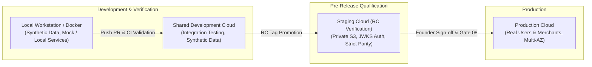

# Environment Strategy and Lifecycle

## 1. Overview and Core Philosophy

FashXStudio defines four explicit operational environments to support safe development, testing, staging verification, and production operation. The platform follows the fundamental infrastructure principle:

> **The Separation Invariant:**
> Code may move freely between environments through automated release promotion. Databases, customer/merchant personal data, uploaded try-on imagery, operational credentials, cryptographic keys, and environment-specific cloud resources must **never** be copied, shared, or bridged casually between environments.

Each environment operates as an isolated operational domain with dedicated storage, identity management, and configuration boundaries.

---

## 2. Environment Definitions

### 2.1 Local (`ENV=dev`, `APP_ENV=development`)
- **Purpose**: Individual engineer development, unit test execution, and fast iteration.
- **Hosting**: Developer workstation, devcontainers, or local Docker Compose.
- **Data Scope**: 100% synthetic mock data or local SQLite/PostgreSQL instances. No real customer or merchant data is permitted.
- **Service Bindings**: Local storage (`backend/storage`), local JWT authentication (`AUTH_MODE=local`), mock VTO inference (`TRYON_PROVIDER=mock`), and local Redis or in-memory caches.

### 2.2 Shared Development (`ENV=dev`, `APP_ENV=development`)
- **Purpose**: Multi-developer feature branch integration, automated end-to-end testing, and continuous deployment from the primary branch.
- **Hosting**: Shared container runtime (e.g. AWS ECS Fargate or dev container cluster) in a dedicated development AWS account/VPC.
- **Data Scope**: Automated synthetic test fixtures and seed catalogs.
- **Service Bindings**: Isolated development database, dedicated development private S3 bucket (`fashx-dev-media-private`), isolated Supabase development project, and mock/sandbox VTO provider.

### 2.3 Staging (`ENV=staging`, `APP_ENV=staging`)
- **Purpose**: Release candidate (RC) validation, performance qualification, security smoke testing, and rehearsal of database migrations under production-equivalent configurations.
- **Hosting**: Isolated staging VPC/cluster mirroring production architecture, network topology, and configuration guardrails.
- **Data Scope**: Anonymized synthetic datasets and controlled merchant pilot test fixtures. Real customer try-on photos and credentials are strictly excluded.
- **Service Bindings**: Dedicated managed PostgreSQL instance, dedicated private S3 bucket (`fashx-staging-media-private`) with 300s presigned URL expiration, Supabase staging tenant (`AUTH_MODE=jwks`), and staging-authorized external API endpoints.

### 2.4 Production (`ENV=prod`, `APP_ENV=production`)
- **Purpose**: Serving live shoppers, retail partners, and commercial virtual try-on inference.
- **Hosting**: Production multi-AZ VPC across private subnets behind an Application Load Balancer / CloudFront distribution.
- **Data Scope**: Live user accounts, authenticated shopper biometric/clothing imagery, verified partner catalogs, and active merchant telemetry.
- **Service Bindings**: High-availability PostgreSQL with read replicas and continuous WAL archiving, private encrypted S3 bucket (`fashx-prod-media-private`), production Supabase JWKS authentication, production FASHN API keys with strict budget limits, and production domain HTTPS CORS policies.

---

## 3. Core Architectural Invariants

### 3.1 Twelve Platform Invariants
1. Each environment has a separate database.
2. Each environment has a separate S3 bucket.
3. Each environment has separate runtime secrets.
4. Each environment has separate IAM task roles.
5. Each environment has a separate Redis endpoint/credential.
6. No non-production workload may access production data.
7. Production tasks run in private subnets.
8. Production storage is private and encrypted.
9. Production authentication uses JWKS.
10. Production deployments require approval.
11. All deployments use immutable image digests.
12. Production rollback restores application task definitions, not automatically the database schema.

### 3.2 Configuration Matrix & Enforcement Layers

| Invariant Area | Local / Dev | Staging | Production | Enforcement Layer |
| :--- | :--- | :--- | :--- | :--- |
| **Database Engine** | SQLite or PostgreSQL | Managed PostgreSQL | Managed PostgreSQL (`postgresql+asyncpg`) | `validate_release_config()` |
| **Object Storage** | Local or S3 | Private S3 (`s3://fashx-staging-media-private`) | Private S3 (`s3://fashx-prod-media-private`) | `Settings._fail_fast()` & `validate_release_config()` |
| **Authentication** | `local` (JWT) or `jwks` | `jwks` (Required) | `jwks` (Required) | `Settings._fail_fast()` |
| **VTO Provider** | `mock` permitted | `mock` permitted for CI; real API for RC test | Real API (`fashn_api`) only; `mock` forbidden | `Settings._fail_fast()` & `release_config` |
| **CORS Invariants** | Localhost / Wildcard dev | Explicit staging HTTPS origins; no `*` | Strict HTTPS production domains only; no `*` | `Settings._fail_fast()` |
| **Debug Mode** | Configurable | Strictly Disabled (`debug=False`) | Strictly Disabled (`debug=False`) | `validate_release_config()` |
| **B2B Merchant Portal** | Configurable | Configurable | `ENABLE_B2B=False` (MVP constraint) | `Settings._fail_fast()` |
| **Retailer Hosts** | Any | Whitelist required | Whitelist required (`FASHX_RETAILER_ALLOWED_HOSTS`) | `Settings._fail_fast()` |

---

## 4. Promotion and Governance Lifecycle

1. **Build Once Principle**: Every release candidate container image is built and tagged once from git SHA (`fashx:${GITHUB_SHA}`). The exact same container image promoted to staging is subsequently deployed to production upon approval.
2. **Schema Migration Compatibility**: All database migrations must follow the expand-and-contract paradigm. Destructive schema changes without a phased transition period are blocked by the engineering standard.
3. **Founder Approval Gate**: Deployments to production require explicit human authorization as governed by repository rule 12. No automated script may merge to `main` or deploy to production unassisted.
